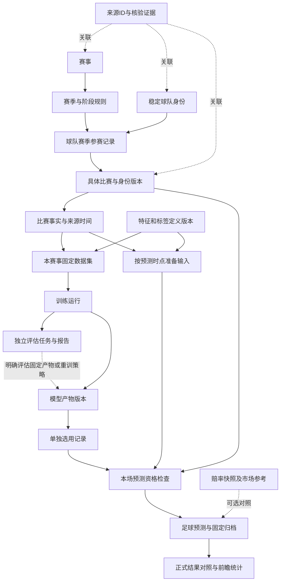

# 足球数据与模型改造方案 v1.1

日期：2026-11-04
状态：待用户核对；尚未批准实施。
配套任务：[football-data-model-refactor-tasks.md](football-data-model-refactor-tasks.md)

v1.1 修订：根据用户对“一起训练与回测”的质疑，补充第 4.4 节的任务拆分、样本边界、固定模型测试与滚动策略回测的区别，修正原方案将所有报告直接挂到最终重训模型的过度简化。仍只修订方案，不执行训练或页面改造。

## 1. 本轮交付与实施边界

本轮只整理程序改造、界面设计、数据隔离、迁移及任务拆分，不运行迁移、不重新训练、不更换选用模型、不发布页面、不提交或推送代码。用户核对方案后按任务执行。界面先提供信息架构、字段与状态设计；真实组件对照的交互原型安排在批准后的 T01，不将本方案中的线框称为已实现页面。

核心结果：接入一个新赛事时，可以逐步完成身份与规则登记、来源匹配、历史采集、数据验收、独立训练、评估、单独选用和新比赛预测。任何一步失败都能定位具体对象、原因和下一步操作。

“支持接入任意赛事”指支持统一扩展流程，不承诺任意外部来源都有数据、任意新球队都满足训练要求、所有玩法都可预测或预测必然准确。真实数据不足时拒绝相应能力，不用其他赛事模型、空伤停列表或市场概率冒充完成。

### 本期必须完成

- 统一赛事、球队、来源身份和赛季参赛关系。
- 分开来源资料、训练数据集、训练运行、模型版本与模型选用。
- 改为按实际模型要求检查预测条件；足球预测和市场参考独立。
- 重构“数据与模型”六个入口，并同步比赛详情的预测与归档读取。
- 用亚冠完成新增赛事的实际纵向接入；以日韩做兼容性验证，以当日所有收录赛事做覆盖核查。
- 保存问题清单、逐场可预测状态、迁移/测试证据。

### 第二期增强，不阻塞基础闭环

球员归属/转会、赛事报名、伤病、停赛、预计与确认阵容的独立维护及历史特征；xG、赛程负荷等增强特征；经评估的跨赛事特征；多模型组合或按目标独立选用。基础字段与扩展位置本期预留，未实现的能力不显示为已启用。

不新增全局混合训练，不把 LLM 接入预测、训练、选用或结算。LLM 继续只处理有证据约束的赛后解释。

## 2. 已核实的现状与需要纠正的地方

依据：`frontend/src/ModelWorkspace.vue` → `api.py` → `service.capabilities` / `competition_workspace.py` → `model_registry.py` / `training_jobs.py` / 赛事训练文件。预测另核对 `service.prediction`、`quality.py`、`readiness.py`、`predictor.py`。

| 现状 | 处理 |
|---|---|
| 已有赛事独立数据目录、固定数据版本、模型/报告摘要校验 | 保留，补齐对象关系和界面入口 |
| 训练生成候选、单独选用观察模型 | 保留；训练任务不得写选用记录 |
| 日职 1392 场采集、1391 场入库 | 保留隔离；差额为 2023 名古屋鲸八—柏太阳神开赛时间冲突，不能凑数入库 |
| 日职/韩职分别有 1391/884 场训练数据 | 是本次核查快照，不是页面常量，不代表所有样本用于回测初始训练 |
| 韩职当前选用泊松、最新候选动态 Gamma–Poisson | 两个运行分别展示；不能把候选报告当当前模型报告 |
| 页面当前模型与候选评估分属不同运行，未清晰标明 | 所有模型、报告、数据版本都按 `run_id` 明确关联 |
| `生产模型：市场基线` 为固定文案 | 删除，市场参考单独展示 |
| `predictor.predict` 主结果来自赔率，足球模型附在 `football_model` | 新归档明确两种结果，足球预测入口不能在无足球模型时保存市场概率充数 |
| 完整伤停/阵容等没有入基础模型，却成为统一预测门槛 | 用模型输入规范替代；基本面覆盖继续提示，不伪造完整性 |
| `enrich_detail` 先通过统一门槛才检查模型 | 拆成身份、模型、输入、市场四类检查，返回真实阻断原因 |
| 队名、来源缩写和训练映射分散 | 建立球队身份和来源映射维护；译名表只负责显示 |
| 训练任务当前主要保存每赛事最近状态 | 增加持久任务历史与运行关联，记录失败、中断及重试关系 |
| 日韩历史采集专门配置较多，新赛事没有通用闭环 | 抽出来源适配器与赛事接入流程；适配器仍需逐个验证覆盖 |
| 当前历史盘口可比样本为 0；报告标为历史研究 | 界面如实展示，不能由均匀基线比较推导已超过市场 |

`docs/football-system-contract.md` 中 `pregame-completeness-v1` 的全量资料硬门槛与本方案有明确差异。待方案批准，在 T00 标记其被新输入规范替代，保留历史实施记录，不将两套规则同时当作现行要求。本轮不修改现行契约。

## 3. 对象关系：先明确谁属于谁



图的解释：数据集固定后不随事实刷新；训练不自动选用；选用变化只影响之后新预测；赛事覆盖是对这些对象的汇总视图，不是另一个独立数据仓库。

### 核心对象最小定义

| 对象 | 关键内容 | 所属与边界 |
|---|---|---|
| 赛事与规则版本 | 稳定 ID、类别、国家/赛区、赛季、阶段、90 分钟口径、中立场/回合规则、规则依据 | 训练政策明确到赛事和允许的赛季/阶段；未知保持未知 |
| 球队 | 稳定 ID、名称、别名、队伍类别、可选俱乐部归属 | 男/女、一线/预备/青年分别识别；俱乐部上级档案不是基础预测必填 |
| 外部身份映射 | 实体类别、来源、来源作用域、外部 ID、内部 ID、有效区间、证据和核查状态 | 同名不自动合并；重叠有效期的冲突映射禁止启用 |
| 参赛记录 | 赛事、赛季、球队、可选分组/阶段、来源与状态 | 同一球队可参赛多个赛事；身份共用、参赛资格不共用 |
| 比赛及修订 | 稳定比赛 ID、赛事/赛季/阶段、双方参赛关系、时间、场地、中立场、状态、修订版本 | 改期/改队新增身份修订；旧归档仍关联旧版本；无法确定是否同场不自动合并 |
| 事实记录 | 比赛/球队/球员关联、字段类型、发生时间、来源发布时间、系统取得时间、来源及修正关系 | 伤病是身体状态；停赛是赛事规则约束，分别记录 |
| 赔率快照 | 比赛、机构、玩法、时段、盘口线、选项、报价、来源和采集时间 | 盘口线/时段不相同不能直接拼接概率 |
| 采集任务与问题 | 来源、赛事/赛季/时间范围、进度、错误、重试、原始记录引用、问题解决版本 | 外部失败不重置旧事实时间；成功空响应与失败分别处理 |
| 数据集版本 | 赛事、来源批次、验收/排除记录、样本清单、特征/标签/映射版本、使用范围、摘要 | 内容固定；总样本数与训练/验证/测试样本数分别统计 |
| 训练运行 | 赛事、固定数据版本、训练样本清单、算法、参数、代码/依赖版本、随机种子、状态与产物 | 一次拟合产生一个明确模型；候选比较由父实验组织独立子任务 |
| 评估任务 | 固定模型或滚动策略、评估范围、预测时点、更新政策、逐场预测与指标 | 固定模型成绩绑定产物摘要；滚动策略成绩绑定配置和各折产物，不冒充最终重训模型成绩 |
| 模型版本 | 方法、参数、输入规范、支持玩法、团队覆盖、训练截止、数据/运行/报告引用及摘要 | 算法名称不代表模型版本；能力必须符合实际产物 |
| 选用记录 | 赛事、模型运行、版本、选用时间、前一选用引用 | 本期每赛事一个默认观察模型；不同玩法分别报告支持/不支持，不偷偷拼接其他模型 |
| 预测与评估 | 固定模型、比赛版本、输入/特征快照、玩法、时点、足球概率、可选市场参考 | 新旧归档明确版本；不可更新原概率来适应新模型或正式结果 |

事实的来源时间可为空，但不能编造。真实赛前输入必须在预测时已取得且符合适用时间；历史模拟若使用“赛后 7 天可用”等假设，要单独标记其政策，不能冒充真实历史采集。完整比赛事实与用于训练的 90 分钟标签分开保存。

## 4. 程序改造方式

保留 Python 服务、SQLite、文件产物、Vue/TDesign，不在本期引入微服务、消息中间件或完整 MLflow/Feast 平台。借鉴其版本、关联和输入规范，避免增加与当前规模不符的运维负担。

| 层 | 现有入口 | 改造责任 |
|---|---|---|
| 身份与赛事规则 | `catalog.py`、配置 JSON、`team_labels.py`、`league_data.py` | 新增身份仓库/服务；来源映射和参赛关系统一读取，显示译名独立 |
| 采集与事实 | `sources.py`、`history_pipeline.py`、`fundamentals.py`、各补采模块 | 统一适配器输出、采集批次、时间与问题记录；保留原始响应和字段级陈旧标记 |
| 数据准备 | `research_dataset.py`、`training.validate_dataset` | 独立验收报告、排除原因、固定数据版本及映射快照 |
| 特征与输入规范 | `training.py`、`model_methods.py`、`readiness.py` | 提取可复用特征构建及模型输入规范；训练/预测同口径；保留各方法真实差异 |
| 训练与评估 | `training_jobs.py`、`model_evaluation.py` | 独立训练/评估/比较任务及父子关系；固定数据与样本边界；明确被评估对象 |
| 模型管理 | `model_registry.py` | 保留完整性校验，新增输入规范索引、精确报告关联、选用历史及并发校验 |
| 预测编排 | `service.py`、`quality.py`、`predictor.py`、`briefing.py` | 分开足球预测、报价质量和辅助覆盖；拆除循环门槛；归档前重新验证关键状态 |
| 结果与解释 | `football_markets.py`、复盘与 AI 模块 | 适配新归档；新旧 schema 分支读取；正式结算与即时初评继续独立 |
| 页面读模型 | `competition_workspace.py`、`api.py`、`ModelWorkspace.vue` | 按资源/范围返回信息；六个子页面独立组件；不让刷新概览触发训练、选用或归档 |

### 4.1 预测检查顺序

1. 核验比赛归属、双方身份、时间与状态；身份不明、已开赛、取消或改期未确认时阻断。
2. 读取本赛事已选用模型并固定 `selection_revision + run_id + model_digest`。没有模型时明确返回缺模型，不回退其他赛事或市场参考。
3. 按该产物的输入规范检查球队样本、必需特征、适用阶段/场地、模型有效期；非输入的伤停/阵容缺失仅作为辅助覆盖提示。
4. 独立检查赔率；胜平负/比分/总进球的足球概率不以报价为前提。让球玩法需明确对应盘口线；盘口缺失时仅该玩法不可用。半全场按实际半场模块与样本判断。
5. 计算足球概率；可用报价生成独立市场参考，任何归一化市场概率不放进足球概率字段。
6. 归档前再次核验未开赛、比赛身份修订、选用修订、必需输入有效时间。其间变化则返回结构化冲突并要求重算，不归档不一致结果。
7. 原子保存新预测、固定输入和来源凭据；相同请求幂等，明确“重新预测”可产生新版本。

建议返回独立字段：`fixture_status`、`model_status`、`input_status`、`market_status`、`auxiliary_coverage`、`markets_ready`、`blockers`、`warnings`。阻断码至少涵盖身份待映射、赛季未登记、模型未选用、模型完整性异常、未知球队、样本不足、必需输入过期、玩法不支持、比赛/选用发生变化；前端显示中文原因与对应操作。

保留当前最低 300 场、3 赛季、验证/测试各 30 场、球队至少 5 场等已有准入阈值作为初始政策，不为跑通亚冠而静默降低。把阈值归入版本化政策；未来变更须独立说明与评估。新球队暂无经验证的先验策略时明确阻断。

### 4.2 预测归档升级

新结果使用明确的 `schema_version`，分别包含 `football_prediction`、`market_reference`、`input_receipt`。主展示与方向来自足球预测；研究状态仍标“观察”，不因成为主展示就宣称生产有效性达标。

旧 `analyses` 原 payload、input_snapshot、创建时间、版本与哈希不变。通过只读解析器区分旧市场参考归档和新足球预测归档；复盘指标按预测类型和版本分别统计，不把旧市场方向计入新足球模型成绩。无足球模型只允许查看市场参考，不通过新“生成预测”按钮归档冒充足球预测。

当前 `service.prediction` 依赖官方在售场次及新鲜 SP；改造后足球预测须有经过验证的比赛状态来源，但不依赖体彩是否在售。未知赛事仍需身份与规则登记，不能通过放开在售条件绕过赛事准入。

### 4.3 API 边界（拟定，T01 固定具体 schema）

- 查询：赛事工作台概览、球队/来源映射、参赛记录、采集任务、问题清单、数据版本、训练运行、指定运行报告、模型版本、选用历史、逐场预测资格。
- 操作：登记/核验映射、启动采集或重试、导入并验收数据、启动训练、选用/停止观察、生成预测。每个写操作校验所属赛事、版本及幂等键。
- 资源路径示例：`/api/v2/competitions/{cid}/overview`、`/datasets`、`/runs`、`/models`、`/selection`；共享球队使用 `/api/v2/teams`，赛事相关资料必须带参赛上下文。
- 旧 `/api/v1` 暂保留兼容适配；新页面不读取混合“最新模型 + 最新候选报告”的旧聚合字段。切换后旧预测写入口不得绕过新规则；不能仅在前端禁用。
- 查询不产生隐式写操作。显示缓存、刷新状态、重新采集使用不同操作。

### 4.4 训练、验证、回测必须怎样拆分（v1.1）

#### 已确认的旧行为与问题

当前控制台 `model_registry.train` 强制单赛事，`model_evaluation.evaluate` 也拒绝多赛事输入。因此不能把现有控制台描述为日韩混合训练。现有流程实际是：按日期切分 → 九组配置分别在验证段滚动拟合与评估 → 冻结验证赢家 → 所有配置在测试段滚动评估 → 用赢家配置按当前可用数据重新拟合最终产物。

滚动拟合会按周初截止过滤已可用历史，并非直接把全部未来赛果喂给每次拟合。此次代码核对不等同完整泄漏审计，仍需 T06 边界测试。真实问题是一个按钮隐藏多种操作，全部候选测试结果持续暴露后该测试段已成研究材料，以及最后重训产物和此前滚动回测的评估对象不同。

原代码在回测报告上追加最终 `model_id`，只能解释为产物来源关联，不能证明“这份报告用这个最终模型逐场预测得到”。迁移时标明旧报告为历史滚动策略研究，不改其原文件。

#### 哪些可以一起，哪些不能

| 情况 | 设计规则 |
|---|---|
| 不同赛事 | 分别建任务、样本和参数；可调度并行，不能混成一个训练模型 |
| 同赛事不同赛季 | 可以使用多个合格历史赛季作为训练窗口，前提是预先明确赛制/阶段政策和时间截止；不要求一个赛季一个模型，也不无条件合并 |
| 同赛事不同球队 | 攻防模型需要同赛事多队对阵共同估计参数，这是正常训练；不是给每支球队单独训练一个互不关联的比赛模型 |
| 多种算法/参数 | 独立子任务，不共享拟合参数；在同一协议和可比比赛集合上比较；不默认每次训练跑全部九组 |
| 训练、验证、测试 | 角色、样本清单、截止时间分别固定；随机打散、目标标签穿越、用测试结果反复选参均禁止 |
| 最终重训与历史评估 | 最终重训产生新产物；历史报告只提供配置/策略依据，不宣称直接测试了新产物 |

#### 页面与任务类型

“训练与评估”可保留一个管理入口，内部拆为“训练任务 / 回测任务 / 候选比较”三个视图与独立操作，取消一键不可区分的“训练与回测”。本期默认操作为单算法训练；候选比较是明确选择候选范围的另一项操作。

| 操作 | 开始前必须明确 | 产物及禁止事项 |
|---|---|---|
| 新建训练 | 单赛事、数据版本、训练时间范围、允许阶段、目标、算法和参数 | 一个固定模型及训练记录；训练本身不产生泛称的测试成绩，不自动回测/选用 |
| 候选比较 | 共同数据/时间协议、预测目标、候选清单、验证范围、选择指标 | 多个独立训练/验证子任务和比较报告；默认不读取保留测试段 |
| 固定模型测试 | 已冻结产物、严格位于拟合数据之后的评估比赛、时点/特征政策 | 对该产物直接评分；不重新拟合参数，若含 Elo 等状态更新必须预先定义并展示策略 |
| 滚动策略回测 | 固定算法/参数/特征/选择规则、初始窗口、滚动范围、更新频率、历史可用时间政策 | 逐折拟合、预测和产物/输入清单；成绩属于更新策略，不属于某一个最终模型 |
| 最终重训 | 已冻结配置、当前合格历史范围、关联实验/评估依据 | 新模型版本，进入待选用；不覆盖回测模型、不自动启用 |

后台可用一个父实验按约定组织任务，仍必须持久保存子任务 ID、状态、样本摘要和依赖。不是把训练与评估分成两个按钮但后端仍无条件跑旧大流程。

#### 时间与样本协议


- 日期边界先于实验固定并显示精确日期和样本数。60/20/20 仅作已有默认起点，不隐藏实际范围；同一天/同轮需遵守协议，不能把后结束比赛的结果给先预测比赛。
- 固定模型保留测试：参数及所有需拟合的预处理/校准只用测试前允许样本。模型训练包含某比赛后，不能将该比赛算作该模型的样本外测试。
- 滚动测试：测试窗较早比赛的结果，只有在真实/声明的可用时间已到且预先规定的下一次更新发生后，才可用于之后比赛的拟合；不允许反馈调参或改选算法。此类结果明确称滚动策略评估，不与固定模型保留测试混称。
- 候选按共同比赛集合报告对比，同时分别报告可预测覆盖、跳过及原因，不选择性删掉难预测比赛美化指标。
- 模型输入计算、归一化、缺失填充、校准、Elo 等状态全部受各折时间限制；全样本预处理后再切分不合格。
- 每个评估记录应有 `evaluation_kind`、`protocol_id`、`selection_frozen_at`、样本清单摘要、数据/特征/规则版本。固定模型绑定 `evaluated_artifact_digest`；滚动回测绑定策略摘要、逐折 cutoff 与子模型摘要。
- 已经反复查看的旧测试区间继续标历史探索。新方案不能把同一批数据改个标签就称独立测试；真正前瞻证据来自未揭晓比赛的固定预测。
- 最终重训可以使用截至训练时已可用的历史比赛（其中可含过去测试段），但其产物是新版本，必须显示“配置有历史评估依据；本版本前瞻观察待积累”。

旧“至少 300 场、3 赛季、验证/测试各 30 场”的政策暂不放宽。任务拆分后分配到相应检查：数据集准入检查总量与赛季，比较/评估协议检查各段样本，正式模型检查球队覆盖；不得每次查询或单次拟合都隐式启动整个回测。

#### 实施任务细分

T06 拆成 T06-A 时间协议与样本清单、T06-B 单独训练任务、T06-C 评估与候选比较、T06-D 最终重训及来源关联四个子任务。T01/T09 同步设计独立操作，T07 区分模型直接评估和策略依据，T11 加入时序与报告归属验收。

## 5. 数据如何隔离

### 5.1 共享什么、隔离什么

| 数据 | 允许共享 | 必须限定的范围 |
|---|---|---|
| 球队/球员稳定身份与核验映射 | 可以被多个赛事引用 | 来源作用域、有效期、球队类别；别名不能越过身份核验 |
| 原始事实 | 可按同一事实引用，不重复造副本 | 比赛、来源、时间、修正版本；进入特征前再判断赛事适用性 |
| 球员伤病事实 | 可被有关比赛引用作核查 | 生效/恢复时间与本场证据；不直接推断完整缺阵名单 |
| 报名、停赛、阶段规则、训练标签 | 不跨赛事复用 | 赛事 + 赛季 + 适用阶段/比赛 |
| 数据集、特征快照、训练运行、模型、评估、选用 | 按赛事独立 | `competition_id` 必填；所有对象引用必须同赛事 |
| 赔率 | 同一快照可供同场多个比较使用 | 比赛 + 公司 + 玩法 + 时段 + 盘口线 + 时间 |
| 历史预测与输入 | 只读引用 | 归档 ID + 固定模型/输入/比赛版本；不随当前指针变化 |
| 页面范围与测试数据 | 不隐式互相影响 | 日期口径明确；测试使用独立 SQLite 和临时训练目录 |

身份相同不等于训练样本可以混用。诸如全赛事休息天数可以在资料中显示，但若要作为跨赛事输入，需要单独政策、时间核验和回测，本期默认不启用。

### 5.2 物理存储与约束

- 新身份、参赛、映射、任务、问题和选用历史使用现有 SQLite 中的增量表。赛事业务查询通过必需赛事上下文的仓库方法执行，不只依靠前端筛选。
- 新引用采用可验证的同赛事键/约束，例如 `(competition_id, run_id)`；存储、服务和文件加载均校验归属。禁止从客户端传入任意产物路径。
- 赛事定义的目标权威源为版本化登记仓库。现有 `config/football_competitions.json` 先作为种子导入，切换后仅作初始种子/导出资料；不得长期维持 JSON 和数据库双写。`catalog.py` 保留兼容读取接口，移除会过期的导入时常量依赖。
- 已存在赛事 ID、比赛 ID 和模型中球队 ID 不改写。通过关联表连接旧 ID 与稳定身份；模型继续使用当时固定映射。冲突旧记录进入待核验，不按名称强行合并。
- 固定产物继续存放 `data/training/competitions/<cid>/datasets/<digest>.json`、`runs/<run_id>/...`。新运行附输入规范、规则/特征/代码版本及验收引用；旧模型的扩展能力说明保存为旁挂元数据，不更改旧文件摘要。
- 当前数据集指针与已选用模型指针独立。选用历史作为唯一业务权威；旧 `observation.json` 迁移后只保留审计或导出用途，不与新权威双向同步。
- 训练任务每赛事排他，不同赛事可独立运行；共享身份写入事务串行校验。任务启动即固定数据版本，后续导入不改变其输入。选用采用版本比较，防止两个页面相互覆盖。
- 原始文件可按内容去重，但业务引用保留来源/采集批次与赛事身份；任何索引重建不得改变已归档内容。

### 5.3 状态不能压成单一进度条

一个赛事可以同时“已有模型使用、新数据待验收、新训练运行中”。分别保存身份接入状态、资料覆盖、数据集验收状态、训练任务状态、模型选用状态和逐场预测资格。概览对这些状态汇总，不用一个“已接通”盖住其他缺口。

## 6. 界面设计

保持现有顶栏、蓝色主题、TDesign 表格、直角和单行数据行。长名称省略并可查看，技术摘要/长 ID/来源证据进入抽屉；不用架构说明、装饰英文或宣传文字占据业务页面。

### 6.1 信息架构

| 页面 | 主内容 | 主操作 | 范围 |
|---|---|---|---|
| 赛事概览 | 登记与规则、数据状态、当前模型、可预测场次、问题 | 查看缺口、进入对应任务 | 可选全部赛事；包含未登记但已收录赛事 |
| 球队与参赛 | 球队、来源映射、赛季参赛、模型样本覆盖 | 核验映射、查看球队档案 | 全部可查身份；赛事模式只查对应参赛关系 |
| 数据接入 | 赛程/赛果、基本面、赔率的来源状态、批次、覆盖、新鲜度 | 采集、重试、查看失败 | 赛事 + 来源 + 日期/赛季 |
| 数据集与质量 | 固定版本、样本范围、纳入/隔离数、问题清单、使用范围 | 导入、验收、查看版本差异 | 必选赛事；可选数据集版本 |
| 训练与评估 | 训练任务、回测任务、候选比较；时间协议、运行详情、报告 | 新建训练、创建回测、候选比较，分别操作 | 必选赛事；明确训练/评估 ID 与被评估对象 |
| 模型与使用 | 当前选用、候选和历史版本、支持玩法、输入要求、前瞻表现 | 选用观察、停止观察、查看报告 | 必选赛事；操作不影响其他赛事 |

当前“基本面、赔率”的供数状态合并到数据接入；逐场资料留在比赛详情。赛事覆盖并入概览。新增球队与参赛、独立数据集质量页。删除固定“生产模型：市场基线”和重复样本表，不删除源数据或历史报告。

### 6.2 顶部与概览线框（信息结构，不是视觉复刻）

```text
数据与模型                      [全部赛事/指定赛事] [业务日期] [刷新状态]

[数据集状态 / 最近赛果日期] [当前观察模型 / 版本] [可预测 n/m] [待处理问题 n]

赛事概览 | 球队与参赛 | 数据接入 | 数据集与质量 | 训练与评估 | 模型与使用

赛事 | 登记状态 | 数据集 | 当前模型 | 可预测 | 最近更新 | 待处理 | 操作
...
```

全部赛事模式使用概览，不显示一个虚构的全局模型。“最近更新”拆清来源采集时间与最新赛果日期，在详情列出；重新请求不能让旧赛果看起来已补新。

可预测比例按明确的请求目标计算，默认“90 分钟胜平负”。分母为选定范围内全部已收录且未开赛、未取消的唯一比赛，包含身份待核验的比赛；未知状态单独列出。分子仅计该目标全部模型/输入检查通过的比赛。比赛取消、完场、身份未知等数量另列，不从分母偷偷删除缺模型比赛美化覆盖。

日期可切换“体彩销售日”和“北京时间自然日”，每次统计携带 `date_basis`、时区、`as_of`；首次延续比赛中心的销售日上下文。两种日期不混合。概览只反映已取得赛程的范围，不称全球全部比赛。

### 6.3 数据集与训练线框

```text
数据集与质量             [赛事] [数据版本] [导入数据]
数据范围：YYYY-MM-DD 至 YYYY-MM-DD    使用范围：本地研究
采集 1392 | 纳入 1391 | 隔离 1       [查看问题]
赛季 | 已采集 | 纳入 | 隔离 | 独立核验 | 半场覆盖 | 操作

训练与评估               [赛事]
训练任务 | 回测任务 | 候选比较
训练： [数据版本] [训练范围] [目标] [算法/参数] [新建训练]
回测： [固定模型/滚动策略] [评估范围] [协议] [创建回测]
比较： [数据与切分协议] [候选清单] [验证指标] [开始比较]
任务 | 类型 | 数据/模型版本 | 时间范围 | 状态 | 操作
评估详情：被评估对象、各段场数、指标、覆盖、跳过原因、研究限制
```

1392/1391/1 是已核实日职示例，禁止写死在页面。独立核验是抽查证据，不作为全部样本质量的代称。市场比较样本为 0 时显示简短状态，隐藏空分数表。历史探索、模拟可用时间、本地研究等限制保留必要标签，详细依据放抽屉。

### 6.4 模型使用及比赛详情

- “当前使用”固定显示实际选用版本、该产物的直接评估以及其策略历史依据（分别标识）；“最新候选”单独显示。历史运行打开其关联报告，不能读取 `latest.json` 替代，也不能把最终重训模型称为此前滚动回测实际使用的模型。
- 选用操作显示赛事、版本、支持玩法和当前替换对象；提交是独立操作。仅停止观察不删除产物或归档。
- 数据集更新时显示“有新数据，当前模型仍使用旧版本”，不自动作废旧模型。
- 比赛详情分开显示“足球预测”“市场参考”“资料缺口”。主预测按钮依据模型能力；只有市场参考时不显示为足球预测成功。
- 无盘口的胜平负预测可显示与归档；让球玩法显示“缺少盘口线”。分类器不显示预期进球，缺半场模块不显示伪造半全场结果。

### 6.5 必须设计的状态

首次接入无数据、来源未配置/失败/限流、资料部分覆盖、映射冲突、历史样本不足、新球队、当前模型与候选不同、训练运行/失败/中断、旧数据模型继续使用、无盘口但可预测、仅部分玩法可用、报告校验失败、改期/开赛期间竞争、无可比市场样本、接口加载失败。

前端不得以异常空对象兜底为“可预测”；刷新不清除未保存笔记。桌面与移动端保持单行表格，窄屏在表格容器内横向滚动，不让整页横向溢出。

## 7. 迁移、发布与回退

1. 先检查当前未提交工作，记录基线；禁止覆盖已有修改。通过 SQLite 一致性备份及不可变产物摘要创建恢复点，不直接复制活动 WAL 数据库当作完整备份。
2. 在副本执行增量迁移：新表、旧数据索引、配置种子、映射候选、数据版本索引、运行/选用历史。新任务历史无法从旧记录证明的字段保持未知，不造完整历史。
3. 幂等迁移：同一迁移重跑不产生重复实体、重复选用、重复预测；歧义记录隔离，不阻止已验证赛事继续使用。
4. 只读对照：新旧模型归属、数据摘要、运行报告、比赛数量、归档内容及个人笔记逐项核对。
5. 采用显式切换标记启用新读取/写入路径；切换时旧新写入口不并行写不同权威。新预测采用新 schema，旧归档保持原样。
6. 分阶段启用后端、原型确认后的页面、比赛预测与复盘适配。构建页面前确认运行的本地服务路径；安全条件允许时刷新用户当前预览并验证资源版本，不仅测试新开标签。
7. 回退优先关闭新写入、恢复旧读取适配，保留新增表和新归档；旧版不能解释新归档时只读保留，不误当旧预测。不得用旧备份覆盖切换后新增用户数据。只有在证明无新写入的窗口才可整体恢复备份。

新系统不自动重训日韩，不自动改选日韩模型。亚冠训练先生成候选并验收；选用作为单独可审计操作，按批准后的执行范围进行，不以训练成功触发。

## 8. 验收口径与完成定义

### 自动化与实际数据两类证据

- 隔离：训练/导入/选用亚冠后，日职/韩职已有数据版本、产物和选用记录不变；故意串入赛事/球队/模型引用必须拒绝。
- 时间：未来事实、赛后补采、修正数据、时区跨日、赛前时点边界、比赛改期与归档期间开赛均有测试。
- 身份：同名不同队、不同来源外部 ID、跨赛事参赛、冲突映射、ID 变更、升班马/新参赛队。
- 训练：启动固定数据，期间导入不改变任务；无完整伤停的合格基础数据可以训练；缺半场不阻断全场目标；不兼容方法不能入选该目标。
- 预测：无赔率可生成受支持足球概率；无模型不能用市场概率冒充；辅助字段缺失不阻断不依赖它的模型；缺必需字段必须阻断。
- 版本：当前模型报告与候选报告分别正确；选用竞争不静默覆盖；旧归档、旧输入、旧模型摘要及个人笔记不变。
- 运行：来源超时/403/429、部分成功、重复任务、服务重启、失败重试、训练中断均可解释；真实来源失败不伪装通过。
- 页面：六个入口、空态、异常态、切换赛事不串数据、桌面/移动、用户当前本地标签资源检查。
- 真实验收：执行日动态枚举销售日与北京时间自然日的全部收录比赛，遍历分页、记录来源范围，完成后重新枚举新增/改期场次。每场报告身份、比赛状态、资料、模型、支持玩法及阻断项，不固定为日韩三场或历史的 12/20 场。
- 新赛事闭环：亚冠实际来源核查、样本验收、独立训练和报告必须有证据。若样本/身份/赛制仍不足，登记具体未完成项，不能将系统能力完成等同亚冠已经可用。
- 若原先“今天”的比赛在执行时已开赛，不补造其赛前预测；回测与赛后分析明确区分，真实前瞻验收改用执行时尚未开赛的场次。

完成分两层：A 为系统改造与迁移通过；B 为目标赛事真实数据/训练/可预测闭环通过。A 通过、B 阻塞时报告“系统已改造，赛事接入未完成”，不能合称全部完成。真实来源清单外的全球比赛不在全量覆盖承诺内。

测试入口沿用后端 unittest、前端 `npm test`、Playwright、构建与真实服务审计；任务文件规定阶段对应检查，不用每次文案改动重跑全部训练。

## 9. 任务顺序与核对点

执行顺序：T00 基线/契约 → T01 接口与界面原型 → T02 身份迁移 → T03 来源与问题 → T04 数据集 → T05 特征与准入 → T06 训练运行 → T07 模型选用 → T08 预测与复盘 → T09 管理页面 → T10 新赛事真实接入 → T11 全量验收与切换。T12 为第二期人员/增强特征任务，不作为基础闭环依赖。

按可运行增量交付，不先推翻整个页面再补后端。T10 的来源可用性调研在 T03 即启动，但真实模型闭环验收须等依赖完成。具体任务输入、输出、验收和依赖见配套任务表。

请优先核对四个方案选择：

1. 六个入口是否采用“赛事概览、球队与参赛、数据接入、数据集与质量、训练与评估、模型与使用”。
2. 是否同意基础足球预测按实际模型必需输入检查，赔率和未入模的辅助资料不一刀切阻断。
3. 是否同意第一期先打通基础赛事模型，人员/xG 等增强特征作为第二期，不拖住主链路。
4. 是否同意以亚冠做新赛事纵向验收，日韩做兼容验证，执行日所有收录赛事做逐场覆盖审计。

以上均为本版建议，尚未获得本轮实施批准。用户可直接标注需要调整的任务或条目。

## 10. 开源参考及采用边界

- [OpenFootball schema](https://openfootball.github.io/schema/)：参考球队、赛事届次、参赛、轮次、球场等对象拆分，不照搬其旧表结构或将日期字段缺失自动补值。
- [SoccerData](https://soccerdata.readthedocs.io/en/stable/intro.html)：参考适配器、来源配置和缓存组织；名称替换不替代稳定身份核验。
- [StatsBomb Open Data](https://github.com/hudl/open-data)：参考赛事/赛季/比赛/阵容/事件的关联，不推断其数据覆盖我们所有目标赛事。
- [Feast point-in-time joins](https://github.com/feast-dev/feast/blob/master/docs/getting-started/concepts/point-in-time-joins.md)：参考按历史时点取特征及防止后补信息泄漏；本期不部署特征平台。
- [MLflow 数据集](https://mlflow.org/docs/latest/api_reference/python_api/mlflow.data.html)、[模型输入输出规范](https://mlflow.org/docs/latest/ml/model/signatures/)、[模型版本管理](https://mlflow.org/docs/latest/ml/model-registry/)：参考数据/运行/模型/报告关系与输入规范，本地实现必要部分。
- [DVC 实验比较](https://doc.dvc.org/user-guide/experiment-management/comparing-experiments)：参考运行对比和参数/指标/依赖分组，不引入额外服务。
- [penaltyblog 概率网格](https://penaltyblog.readthedocs.io/en/master/models/football_prob_grid.html)：参考模型输出到玩法的分层，不将开源算法可用视为本赛事效果已验证。

这些来源用于结构与工程设计。是否采用某个库、采集器或数据集，仍需实际兼容测试、覆盖验证和使用范围核对；本方案不宣称已经完成这些软件的本地接入。
