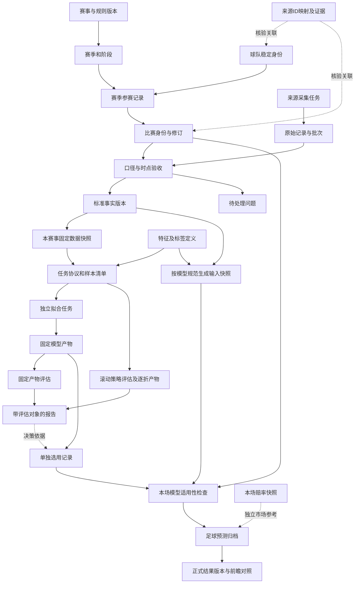

# 足球数据与模型改造方案 v2

日期：2026-11-04。状态：核心链路已发布；覆盖缺口和剩余验收见执行记录。
[任务与验收](football-data-model-refactor-tasks.md) · [本次复核及撤回的设计](football-data-model-refactor-review.md)

本版完整替换 v1.1。旧稿保存在 `.design/football-data-model-refactor/archive/`。用户确认按任务和验收清单执行；页面仅保留必要操作和状态，实际缺失不伪装完整。执行证据见 `docs/reports/2026-11-04-refactor-execution.md`。

## 1. 先明确要交付什么

目标是让每个赛事都有一条可核查的链路：登记 → 来源与球队匹配 → 历史数据验收 → 本赛事训练/评估 → 候选模型 → 单独选用 → 新比赛预测 → 归档和结果对照。

本期交付三个结果：

1. **业务可操作**：用户能查出某赛事、某球队、某场比赛卡在哪里，并有对应处理入口。
2. **程序不混用**：赛事样本、训练参数、模型、报告和选用隔离；市场参考和足球预测分开；数据/模型更新不改历史。
3. **真实闭环有证据**：亚冠作为新赛事试点，日韩作为既有模型兼容验证，执行日全部已收录比赛作为覆盖审计范围。

“任意赛事可接入”是可扩展工作流，不是保证任意外部来源有足够数据、任意球队都可预测。无法取得某赛事/球队所需数据时明确列缺口。工程改造通过但亚冠闭环未完成时，整体用户目标仍未完成，不能用模拟数据宣称完成。

本期先实现以同赛事历史赛果为基础的研究/观察预测。完整球员主档、转会/报名、伤停、xG 和跨赛事增强特征安排第二期；已有真实资料展示继续保留。未进入模型的资料不当作基础预测必填。LLM 仍仅用于有证据约束的赛后解释。

## 2. 已知事实与本次修订依据

| 已核实事实 | 设计含义 |
|---|---|
| 控制台已强制赛事独立，固定数据/模型文件已有摘要校验 | 不推倒已有隔离；不能声称此前控制台把日韩混在一个模型训练 |
| 单按钮当前执行九组配置验证、测试比较，再重新拟合最终模型 | 阶段与产物需显式关联；自动编排本身合法，隐藏阶段和混淆报告才是问题 |
| 当前回测按周截止拟合，再按当前可用数据生成最终产物 | 滚动策略成绩不等于最终新模型直接测试成绩 |
| 日职采集 1392、入库 1391；一场开球时间冲突被隔离 | 展示具体问题，不为数字一致解除隔离 |
| 韩职当前选用泊松，最新候选为动态 Gamma–Poisson | 当前模型、候选和报告必须通过明确 ID 关联 |
| 当前主预测字段来自市场报价，足球模型另附 | 新归档分开预测类型；旧字段不能换含义而无 schema 版本 |
| 完整伤停/阵容未入基础模型，却成为统一门槛 | 改成模型实际输入规范；仍保留真实资料缺口 |
| 来源名称/球队映射分散，暂无统一球队维护 | 补身份与参赛关系，不把译名表当实体主键 |
| 旧数据/模型读取部分依赖当前赛事准入规则 | 历史完整性校验与当前新训练准入分离，避免改规则使旧模型无法读取 |
| 构建直接输出并清空 `web/console`，发布脚本删除旧资源 | 验证构建与发布切换分开；保留旧客户端需要的资源 |

依据文件：`ModelWorkspace.vue`、`catalog.py`、`model_registry.py`、`training_jobs.py`、`model_evaluation.py`、`model_methods.py`、`quality.py`、`readiness.py`、`service.py`、`predictor.py`、`store.py`、`frontend/vite.config.js`、`frontend/scripts/publish.mjs`。本次为代码/文档审查，不等同完整运行验收。

## 3. 四个概念必须分开

| 概念 | 回答的问题 | 不代表什么 |
|---|---|---|
| 数据可用 | 身份、口径、时间和使用范围符合本次任务吗？ | 不代表所有辅助资料齐全 |
| 模型可计算 | 指定模型支持本场球队、阶段、时点和玩法吗？ | 不代表已证明预测效果 |
| 评估证据 | 哪个模型/策略在什么范围取得何种成绩？ | 不代表所有未来赛事都适用 |
| 已选用观察 | 用户明确选用哪个版本做后续观察？ | 不代表生产发布或保证准确 |

本期不增加缺乏依据的“已达生产标准”状态。算法多、训练成功、优于均匀概率都不能替代独立前瞻证据；没有可比历史赔率不声称超过市场。

## 4. 完整关系图



上图不要求所有任务手动逐个点击；父实验可以按预先声明的顺序自动组织子任务，但每个子任务的输入、输出、错误和状态必须独立可追溯。选用仍是独立操作。

### 4.1 身份与事实

- **球队**：稳定 ID、名称/别名、队伍类别、可选俱乐部关系。男/女、一线/青年/预备队不按名称自动合并。
- **参赛**：球队 × 赛事 × 赛季，必要时附组别/阶段。升降级或跨赛参赛不改变球队身份。
- **来源映射**：实体类型、来源命名空间、外部 ID、内部 ID、有效期、证据和核查状态；同一作用域有效期重叠的冲突禁止启用。
- **比赛**：稳定比赛 ID、双方、赛事/赛季/阶段、开球时间、场地/中立状态、赛制、状态和修订。改期保留历史版本；无法判断是否同一场时隔离，不强行合并。原有比赛 ID 不重写。
- **事实**：来源内容与规范化值都保留，记录发生、发布、取得、修正时间；未知时间不编造。更正或撤回新增版本并标识取代关系。
- **结果**：90 分钟、加时、点球、晋级分别保存；即时初评与正式确认分开。训练标签引用具体结果版本和标签定义。
- **人员扩展**：球员归属、赛事报名、停赛、伤病、本场阵容分别建关系。伤病不等于规则禁赛；正式阵容可以独立采集，不等待完整人员库。

### 4.2 数据集、任务和模型

| 对象 | 固定内容与引用 |
|---|---|
| 数据快照 | 单赛事历史事实、身份/规则版本、来源批次、使用范围、纳入/隔离清单、摘要；不内嵌所有算法的一份通用特征矩阵 |
| 样本/特征视图 | 数据摘要、特征版本、标签定义、预测时点政策、训练/验证/测试样本清单及摘要；不同方法可以有不同输入 |
| 实验协议 | 目标、候选范围、时间窗口、更新政策、选择指标、比较集合、最小样本和新球队政策 |
| 拟合任务 | 单赛事、固定样本清单、算法/参数、代码/依赖/种子、拟合截止、状态、输出产物 |
| 模型产物 | 参数、所需状态、输入规范、支持玩法、球队覆盖、适用阶段/场地、训练任务引用和摘要 |
| 评估任务 | 被评估的固定产物或滚动策略、评估范围、逐场/逐折输入和输出、覆盖、指标及限制 |
| 选用记录 | 本赛事的模型版本、修订号、选用时间、原版本；不等于最新候选 |
| 预测归档 | 预测类型、比赛修订、选用修订、模型摘要、实际输入、特征状态、来源凭据、玩法、概率、时间与 schema |

## 5. 训练、验证和回测如何设计

### 5.1 允许共同使用的范围

- 不同赛事分别训练，不共享拟合参数或偷偷借模型；可以调度并行。
- 同赛事多个历史赛季可以组成时间窗口，但必须有明确赛制/阶段纳入政策；不是每赛季都要单独模型，也不是同名赛事历史无条件合并。
- 攻防模型需要同赛事多支球队的对阵共同拟合。球队身份独立维护不代表每队各训练一个无法对照的模型。
- 不同算法/参数为独立子任务；共享经过核验的原始数据和确定性缓存，不共享拟合参数。
- 训练、验证、评估比赛的角色和时间边界必须由样本清单证明，不能只在页面显示三个数字。

### 5.2 两种可选工作方式

**单独训练**：指定赛事、数据版本、训练窗口、目标、算法/参数，输出固定产物。训练本身不伪造测试成绩，不触发选用。

**显式实验流程**：用户选择协议与候选后，可自动执行候选训练 → 验证比较 → 冻结配置 → 评估 → 可选最终重训；开始前显示各阶段、数据范围与产物，阶段失败停止依赖阶段。可以单独重试失败子任务，不自动重跑已完成阶段。

多个阶段自动执行是允许的。需要消除的是当前“训练与回测”按钮没有说明究竟运行什么、数据用在哪里、最终成绩属于谁。

### 5.3 两类评估不得混称

| 类型 | 模型参数 | 数据/状态更新 | 报告归属 |
|---|---|---|---|
| 固定产物评估 | 固定，不重新拟合 | 输入若允许更新，必须使用产物已经声明的状态更新政策；否则冻结 | `artifact_digest + input_policy_version` |
| 滚动策略回测 | 按预先固定频率重新拟合 | 每折仅使用当时已可用样本，保存 cutoff、样本和子产物摘要 | `protocol_digest + fold_artifacts` |

训练后的最终重训产物是新版本，可以引用历史策略报告作为依据，不能声称该报告直接测过这个新版本。旧回测记录不改写，仅在新查询层说明其实际评估口径。

### 5.4 时间纪律与比较规则

1. 开始前固定数据、候选、切分、选优指标和评估方式；60/20/20 仅是已有默认起点，页面显示实际日期与场数。
2. 验证段用于选择配置，保留测试段不用来反复调参。已看过的旧测试段继续标历史探索；改变名称不使其重新独立。
3. 滚动策略允许较早评估比赛的结果在其可用时间到达后进入后续折，但只能遵守事先冻结的更新策略，不得据此改变算法/超参数。
4. 缺失填充、归一化、校准、Elo 状态及任何学习步骤都受同样截止限制。全样本拟合预处理后再切分不合格。
5. 每个方法声明特征状态是“拟合时冻结”还是“预测时按已知事实更新”。旧产物按其原语义恢复，不能把新实时特征直接接到旧权重上。
6. 候选既报告共同比赛集合上的指标，也报告各自覆盖和跳过原因；覆盖太少或共同集合不足时不产生胜出结论。选择指标、最低覆盖及样本阈值在协议里固定。
7. `full_time` 是要求支持全场比分相关玩法的能力目标，不等于多玩法综合优化；当前仍按胜平负验证误差选优，必须标明。分类器只适用于胜平负目标。
8. 旧工作流三赛季/300场、验证/测试各30场、球队5场、模型30天有效期等政策暂不静默放宽。分别归入相应工作流/模型政策，不把它们称为所有算法的科学定律。小样本试验可记录研究结果，但未满足观察准入时不得选用。
9. 固定产物新观测样本不足时可以展示已积累数量，不制造回测通过结论；技术检查通过可以进入明确的研究观察，不等于通过生产质量发布。

亚冠具体赛制、跨历史时期连续性、中立场和球队样本不足时需明确纳入/排除政策。旧模型不支持中立场就不能假定名义主队有主场优势；先限制适用范围，再决定是否建立新模型版本。

## 6. 模型选用与比赛预测

### 6.1 模型管理

本期每赛事保留一个默认观察模型；它支持哪些玩法就提供哪些，不默默调用其他模型补全。多目标选用/组合属于后续独立设计。选择分类器时明确提示只支持胜平负。

选用必须通过身份/产物完整性、输入规范、适用范围和使用范围检查，展示评估限制，并记录操作。训练完成只产生候选。历史已有选用保持，不能借此次迁移自动改选。

停止新训练、暂停来源采集、停止模型观察是三个独立操作。规则更新后旧产物仍可按其固定历史政策读取；是否限制它预测新的比赛，由当前明确的适用/撤销政策决定，不以“旧文件读不了”代替停止观察。

### 6.2 逐场检查和写入

1. 校验比赛身份、赛事/赛季/阶段、双方、当前状态及状态来源时效。未开赛状态不能只凭未来开球时间推断。
2. 固定选用修订、模型摘要，以及本次引用的规则、球队映射和比赛修订，检查模型适用性和球队覆盖。
3. 按产物规范准备输入，缺必需输入阻断；缺未入模的伤停/首发仅提示。当前球队无足够同赛事样本时不能借联赛参数兜底。
4. 分玩法判断：基础足球概率与体彩在售状态/报价无关；让球需明确相应盘口线；半全场需有效半场能力。无足球模型时只读市场参考。
5. 计算足球结果，赔率可用时另外计算市场参考；不混合到一个未标来源的概率中。
6. 保存前在短临界区检查本次引用的选用、比赛、映射、适用规则修订与输入有效性，数据库最终校验和插入同一事务。计算期间发生关键修订则拒绝此次归档，要求重算；不因无关赛事/球队资料更新阻断。
7. 幂等键相同且请求摘要相同返回同一结果；同键不同参数拒绝。明确的重新预测使用新键并追加版本。

网络请求不放在长事务或文件锁内。先获取事实并固定凭据，提交时只做本地一致性校验。跨进程使用按赛事的短提交锁，按“文件提交锁 → SQLite 事务”的统一顺序，选用更新与预测提交使用同一约束；它与长时间训练排他锁分开，训练运行不应锁死正在使用的模型预测。无法保证上游零延迟，报告记录实际核验时间和来源延迟边界。行情或比赛源未知/冲突时按对应能力阻断，不宣称事实绝对实时。

### 6.3 新旧归档和结算

- 新 schema 分开 `football_prediction`、`market_reference`、`input_receipt`。旧 payload、input_snapshot、ID、时间、版本和内容不重写。
- 旧归档既可能有市场主结果，也可能有足球附加结果；只读解析器按真实内容分别展示，不能一律抹成市场或一律算足球模型成绩。
- 预测目标带玩法、90分钟/其他时段和盘口定义；只能与相同口径的正式结果比较。市场回报需要当时有效报价，不补造历史盘口。
- 正式结果修正追加对照版本，不改旧预测；即时初评、正式核对与 AI 解释各有来源和版本。未确认结果保持待定，不填为零。
- 相同比赛多次预测不直接当多场比赛计算命中。前瞻协议事先规定每场/每玩法/每模型版本采用哪个预测时点，其他版本保留审计；不事后挑最准的一版。

## 7. 数据隔离与最小迁移

### 7.1 权威来源：本期不整体搬迁

| 内容 | 本期权威来源 | 新增内容 |
|---|---|---|
| 赛事定义与规则 | 现有配置及不可变规则版本快照，经唯一服务更新 | 配置摘要/修订、动态读取；数据库只作可重建索引 |
| 球队、来源映射、参赛关系 | SQLite 新增表 | 核验依据、有效期、修订与唯一约束 |
| 比赛、事实、归档 | 现有 SQLite，增量扩展或新表 | 版本链接、事实时间、来源批次，不修改旧归档 |
| 数据集/模型文件 | 现有赛事独立目录 | 新 manifest/输入规范；旧产物旁挂解释元数据 |
| 当前数据/候选/选用 | 现有文件注册表和指针，经唯一服务更新 | 指针修订及不可变操作记录，索引可重建，不在数据库另建第二套选用权威 |
| 任务、问题与查询索引 | SQLite 新增表 | 持久状态、父子任务、重试、问题处理和引用 |

同一服务内所有更新经过统一接口，不允许新旧路径各改一套状态。外部手工文件修改通过摘要变化检测，未核对前不继续写入。未来若改权威存储，应另建明确迁移任务；不与本次业务重构捆绑。

### 7.2 隔离必须同时落实在五层

1. **引用**：数据集、任务、产物、报告、选用必须有 `competition_id`，交叉引用校验归属；共享球队身份不共享参赛资格/停赛/模型参数。
2. **查询**：赛事仓库查询必带上下文；球队全局身份查询与赛事参赛查询分接口。未知赛事以来源命名空间独立发现，不依赖不可靠通用 league_id 合并。
3. **文件**：沿用 `data/training/competitions/<cid>/datasets/<digest>.json` 和 `runs/<run_id>/`；文件加载核验路径、摘要、赛事及规则/数据引用。
4. **任务**：同赛事重型任务排队，父实验调度子任务不得重复占锁死锁；不同赛事可独立运行。启动即固定版本，导入更新不改正在训练的输入。
5. **归档**：预测记录固定映射/模型/规则/输入修订。新增映射可帮助之后预测匹配旧模型已有球队，但必须可追溯且不修改旧模型映射；未知球队不能凭新名字映射变成已学过。

v2 单赛事导入严格拒绝混入其他赛事。现有兼容批量导入可按赛事显式分区并返回各分区结果，不能静默丢弃；两种接口不得互相矛盾。

### 7.3 时间、发布与故障恢复

- 不可变事实/数据/模型先写临时产物、校验、原子发布，再更新权威指针；任务完成状态最后写入。文件和 SQLite 不是一个原子事务，程序必须对账恢复。
- 指针更新记录前版本、新版本、操作 ID；中断后依据权威指针对账，不凭数据库最近状态猜当前模型。未完整发布产物不可选用；未引用临时产物先隔离，不清理旧有效文件。
- 实时输入限制在预测时已取得且适用的事实版本。历史模拟使用可用时间假设时，协议和报告显式记录；不得与真实采集回放混称。
- 修正后的事实不重新计算旧预测。新数据版本可采用修正事实；旧报告继续指向旧版本，必要时追加审计说明。
- 新规则不能追溯改写旧文件。读取旧产物校验历史固定规则和摘要，新训练检查当前准入；读取和新使用权限分别判定。旧产物缺少原始规则版本时，迁移只记录可证明的兼容基线及来源，不倒填为当时真实规则版本；无法证明的适用能力待核验，历史原文仍可只读查看。

## 8. 界面如何组织

保持现有顶栏、蓝色 TDesign、直角、单行表格、简短中文。六个入口是管理视图，不要求六套独立存储。技术版本和长说明放抽屉，必要的状态、时间、研究限制留在业务页。

| 入口 | 必须回答的问题 | 内容/操作 |
|---|---|---|
| 赛事概览 | 哪些赛事已接入，哪些比赛可预测，卡在哪里？ | 包含未登记赛事；状态、当前模型、目标玩法覆盖、问题跳转 |
| 球队与参赛 | 这支球队是谁，在本赛事有没有数据？ | 稳定身份、来源映射、赛季参赛、当前模型样本；核验映射 |
| 数据接入 | 哪个源取到了什么，什么时候取的，失败在哪？ | 赛程/赛果、基本面、赔率分组；采集、重试、批次与问题 |
| 数据集与质量 | 本版哪些样本可用，哪些被排除，为什么？ | 数据版本、范围、纳入/隔离、使用范围、版本差异 |
| 训练与评估 | 这次运行学了什么、怎么测、测的是谁？ | 训练/评估/实验列表，协议、父子任务、产物、独立报告 |
| 模型与使用 | 当前到底用哪版，支持什么，证据是什么？ | 当前选用、候选、历史版本、直接评估/策略依据/前瞻成绩；独立选用 |

### 8.1 核心线框（非已实现视觉稿）

```text
数据与模型                    [赛事范围] [适用日期与口径] [刷新状态]
数据集状态 | 当前观察模型 | 胜平负可预测 n/m | 待处理问题
赛事概览 / 球队与参赛 / 数据接入 / 数据集与质量 / 训练与评估 / 模型与使用

数据集： [赛事] [版本] [导入并验收]
采集唯一比赛 1392 / 纳入 1391 / 隔离 1     [查看问题]
赛季 | 纳入 | 隔离 | 最近赛果日期 | 操作

训练与评估： [赛事]       [新建训练] [新建评估] [新建实验]
任务 | 类型 | 数据/模型 | 时间范围 | 状态 | 操作
运行详情：协议、样本、阶段、产物、报告

模型与使用：
当前使用：版本、支持玩法、训练截止、直接评估/策略依据/前瞻样本
候选/历史：版本 | 训练数据 | 适用范围 | 证据状态 | 操作
```

1392/1391 是已核实示例，不是页面常量。“新建实验”可串联训练和评估；只在用户明确选定流程后执行，绝不训练成功即选用。

### 8.2 去掉与保留

- 去掉固定“生产模型：市场基线”、重复数据总量表和没有样本的空指标表；零样本显示简短原因。
- 原“基本面、赔率”的供数状态合并入数据接入；逐场明细仍在比赛详情，事实不删除。
- “双源核对”移为可展开的独立核验证据，显示核查范围、一致/冲突/未核查；不把未抽查等同错误。
- 数据质量、来源使用范围、模型效果分别显示。当前本地研究与第三方权利未确认并存，不错误显示为商用已许可。
- 默认不把九组配置等同九个可选模型，也不把新候选指标贴到当前模型。

### 8.3 统计与交互口径

概览显式带日期类型（体彩销售日或北京时间自然日）、时区、目标玩法、统计时点和来源范围。分母为该范围内已收录、可确定日期且未开赛/未取消的唯一比赛，身份未映射或缺模型的仍计入；时间/状态无法确定的另列“待核查”，不得悄悄忽略。分子为该目标技术资格通过的场数，不表示资料全齐或效果达标。

“全部赛事”允许查概览与身份，不显示全局模型，也不允许未选赛事直接训练。切换赛事/版本的旧请求响应不得覆盖新范围。数据查询、刷新状态、重新采集是不同操作；页面读取不隐式创建训练/预测。

空态/失败态必须覆盖：未登记、无映射、样本不足、新球队、采集限流、数据冲突、任务中断、模型损坏、当前与候选不同、规则更新、部分玩法可用、无赔率、比赛改期、加载失败。按钮依据服务器检查，不靠前端兜底空值放行。

## 9. API、迁移与发布

- v2 按赛事数据集、任务、产物、评估、选用和比赛资格划分资源；所有写操作校验范围、修订和幂等。冻结具体 schema 后才能前后端分开实现。
- v1 读取保留兼容，旧市场主结果与新足球主结果不复用同名字段暗改含义。旧写入口通过同一新应用服务处理，无法兼容则明确提示更新客户端，不能保留绕过门槛的路径。
- 状态迁移只新增表/索引/旁挂元数据；已存在文件、预测、笔记、收藏和选用保持。未知旧字段不补造，历史任务只有最近一条则诚实导入一条。
- 真实迁移前做 SQLite 一致性备份和文件摘要；在副本验证幂等、数量、关联和恢复。当前未提交代码不得重置。
- 配置/指针切换的读写窗口短暂受控；后台旧采集/任务写入也必须经过统一服务，不能只管用户 API。
- 先构建到独立输出目录并测试，不能把当前会清空 `web/console` 的构建当无副作用检查。发布时原子切换入口并保留旧资源/读取兼容窗口，检查用户当前标签资源版本；未保存输入存在时不得强制刷新。
- 回退先关闭新写入、保留新归档并切回兼容读取。切换后有新用户数据时不能用旧备份整库覆盖。旧客户端不能解释新 schema 时只读提示，不按旧格式误算。

现行契约中的全量资料门槛，在相应实现通过且切换时才标为已替代；方案批准只批准目标，不让文档提前声称程序已经改变。

## 10. 场景验收矩阵

| 场景 | 必须出现的结果 | 证据 |
|---|---|---|
| 日职训练期间导入新版数据 | 旧任务继续使用启动时摘要；新版只供后续任务 | 任务/产物与两版摘要 |
| 亚冠训练、选用 | 日韩原数据/产物/指针不变 | 操作前后完整性清单 |
| 一支球队同时参加联赛/杯赛 | 身份同一，参赛、资格、样本、参数分别归属 | 映射和隔离测试 |
| 同名青年队与一线队 | 不自动合并；歧义待核验 | 冲突记录 |
| 取消训练许可或改变阶段规则 | 历史可读；新训练按新规则；是否停用独立决定 | 历史读取与新准入测试 |
| 新球队 ID 已映射但历史不足 | 映射成功仍报告模型样本不足，不借其他赛事 | 逐场资格结果 |
| 缺伤停/首发但基础模型不使用 | 允许其支持玩法，保留资料缺口 | 输入规范和预测快照 |
| 没有赔率或体彩未在售 | 已核实比赛且基础模型有效则可算基础概率；市场参考缺失 | 新归档分栏 |
| 分类器/缺半场能力/缺让球线 | 仅相关玩法不可用，无占位概率 | 玩法能力测试 |
| 后补首发或修正赛果 | 不倒灌旧预测；新数据版本独立 | 前后快照摘要 |
| 固定模型与滚动回测 | 报告对象不同，滚动每折可回放 | 产物/策略/折索引 |
| 比较时某算法跳过大量比赛 | 展示覆盖与共同集合，不能用不同集合直接判胜 | 比较报告 |
| 最终模型重训 | 新产物不冒认旧策略直接测试成绩 | 关联类型与页面 |
| 计算期间换模/改期/开赛 | 提交时冲突拒绝，不生成错误归档 | 竞争测试及数据库检查 |
| 同一预测请求重复发送 | 同键同参数同结果，同键异参数拒绝 | 幂等测试 |
| 发布产物后进程中断 | 未完成状态可恢复对账，不能引用半个模型 | 故障注入测试 |
| 来源超时/403/429/成功空响应 | 旧时间不伪刷新；空响应与失败不同处理 | 批次和字段状态 |
| 同比赛多个预测版本 | 固定协议选择观测版本，不按最优结果挑选 | 前瞻统计清单 |
| 原地发布时旧 SPA 仍打开 | 旧资源可读、旧写入不可绕过，用户数据不丢 | 当前标签与版本检查 |
| 目标比赛已开赛才完成接入 | 不补造赛前预测，用之后真实未开赛比赛验收 | 归档时间与赛程 |

执行日全量审计从当前来源枚举全部已收录比赛、遍历分页、核查销售日与自然日范围，结束时再发现新增/改期。报告每场资料、模型和玩法状态，不能写死为三场或此前 12/20 场。

完成报告分别列工程验收、亚冠闭环、日韩兼容、其他赛事覆盖、前瞻效果证据。工程通过不替代真实数据闭环，前瞻尚无足量样本不填写通过。

## 11. 执行顺序与已批准边界

用户已批准实施。已按身份 → 来源 → 数据 → 任务/评估 → 模型 → 预测 → 迁移/页面 → 真实闭环 → 切换推进。保留任务 ID，T01 提前承担可行性核查，T06 按 A–D 明确子任务。实际验收和未完成项以 `docs/reports/2026-11-04-refactor-execution.md` 为准，方案本身不是完成证明。

本版已批准的核心选择：

- 六个管理入口保持上述划分，训练/评估内部是独立任务，可显式编排，不增加机械操作负担。
- 本期保留现有存储权威，只做必要增量迁移，不一边重构业务一边整体搬迁注册表。
- 先交付基础研究/观察模型闭环；人员增强不阻断基础模型，但缺模型必需输入必须阻断。
- 亚冠是目标真实试点，源/规则/球队不足提前报告，不强行宣称任意比赛已可预测。

## 12. 参考与采用边界

此前已核对的官方资料仅用于设计借鉴，不表示这些库已经接入或覆盖目标赛事：

- [OpenFootball schema](https://openfootball.github.io/schema/)：对象与参赛关系。
- [SoccerData](https://soccerdata.readthedocs.io/en/stable/intro.html)：来源适配与缓存；名称归一不替代身份核验。
- [StatsBomb 开放数据](https://github.com/hudl/open-data)：赛事、赛季、比赛、阵容与事件关联。
- [Feast 时间关联](https://github.com/feast-dev/feast/blob/master/docs/getting-started/concepts/point-in-time-joins.md)：历史时点与后补数据边界。
- [MLflow 数据集](https://mlflow.org/docs/latest/api_reference/python_api/mlflow.data.html)、[模型规范](https://mlflow.org/docs/latest/ml/model/signatures/)、[版本管理](https://mlflow.org/docs/latest/ml/model-registry/)：固定输入、产物与评估关联。
- [DVC 实验比较](https://doc.dvc.org/user-guide/experiment-management/comparing-experiments)：实验参数、依赖与指标关联。
- [penaltyblog 输出](https://penaltyblog.readthedocs.io/en/master/models/football_prob_grid.html)：比分分布到玩法的转换。

本期沿用 Python、SQLite、文件产物和 Vue/TDesign，不引入大型平台。设计已重新审查，不等于实现无漏洞；必须用上表的场景和真实数据完成验证。
