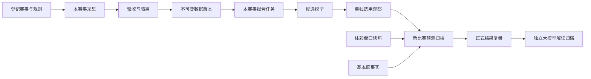

# 足球工作台：功能边界与执行约束

更新：2026-11-06（五大联赛逐场数据和赛前证据复核）。本文与根目录 AGENTS.md 是后续开发的入口。修改功能时先核对本文和实际代码；不以聊天记忆代替约束。

## 2026-11-05 五大联赛数据准入

- 英超、西甲、德甲、意甲、法甲分别登记并导入内容寻址数据集，合计9,358场；范围为2021/22起五个结束赛季及2026/27已完场。行政改判与中止比赛不作正常90分钟标签。来源修正须保留逐场证据及显式准入政策。
- 本轮只完成本地研究数据准入，不拟合、不选择观察模型；五赛事预测阶段尚未开放。公开可访问不等于商业授权，来源商业权利仍未核实。
- 五大联赛9,358场均有双方赛后xG。9,353场有来源公布的球队测量，最后5场单独保留按完整射门事件求和的测量。不同来源、指标定义、精度与历史可用时间分别保存。比赛结果的七天延迟属于回测假设。增强特征需单独验收、时间切分与消融评估。
- 五大联赛通过采集、补充和导入脚本完成。新增 `scripts/refresh_big_five.py` 可检查指定赛季新完场记录，只追加研究快照；旧身份/比分变化会要求核查，不覆盖原标签，导入仍独立。已联网核对452场当前赛季结果；控制台任务和无人值守定时尚未接通，不将脚本试跑描述为持续服务。当前比赛资料覆盖与历史数据集覆盖分别报告。
- 真实数量、来源证据、剩余缺口和复现入口见 `docs/reports/2026-11-05-big-five-supplement-and-import.md`。
- 同日后续补采、120场剩余xG缺口和增量更新验收见 `docs/reports/2026-11-05-big-five-gallery-and-refresh.md`。
- 最新一轮补入23场后剩余97场；英超当前样本xG完整，但不代表历史伤停或赔率齐全。日期例外、供应商隔离及实际核验见 `docs/reports/2026-11-05-big-five-final-gaps.md`。
- 再次补采新增82场后，xG剩余15场；球队与球员xG数值差异保存为诊断，不自动判错或互相覆盖。备用来源、字段缺口与85项验证见 `docs/reports/2026-11-05-big-five-depth-and-quality.md`。历史伤停、赛前名单发布时间与多年时点赔率仍未齐全。
- 官方逐场日期核查再补2场xG，剩余13场；5场西甲的角球、控球、犯规、传球及黄牌补入独立官方来源，9,358场均有这些字段。红牌仍有5场双方值不完整，不将省略字段默认为零。射门16/17的来源差异保留诊断，不覆盖旧事实；93项验证与新数据版本见 `docs/reports/2026-11-05-big-five-official-reconciliation.md`。
- 11月6日用完整事件档案核对剩余13场xG，补入5场官网明确展示的红牌值，核实2场双方赛前公布的首发。全批有323场ESPN统计同时记录双方控球和射门为零，整组来源隔离。射门及射正经替代来源补齐，其余角球、控球、犯规、传球和牌数各有9,035场通过当前检查。以 `docs/reports/2026-11-06-big-five-event-evidence.md` 的复核口径为准。

- **最新验收**：323场双侧异常和19场单侧异常均已补入替代来源。9,358场均有通过结构及比赛身份检查的双方射门、射正、角球、控球、犯规、传球和红黄牌。传球保留来源口径，334场两份加总有差异。采集和覆盖检查均识别单侧占位零值。1,710场英超有部分赛前FPL人员状态，8场有独立市场参考报价，2场有双方首发发布时间。逐场缺口、季别覆盖和实际服务核验见 docs/reports/2026-11-06-big-five-completion-audit.md。

## 2026-11-05 每日扫盘命中

- 合并前复核：后端485项（484通过、1跳过）、前端单元18项和页面回归21项通过；随后补正比赛身份变化时同时清空该次核对的命中及收益字段，针对扫盘、进取观察和官方赔率27项通过。已有结算版本保持原样，新核对追加版本。提交只包含代码、测试、文档与当前构建资源，本地账本、复盘数据、日志和SQLite不随提交同步。

- 赔率时段对比补充：默认突出最近相邻两条实际报价的北京时间、旧值→新值、差值与相对涨跌幅；隐含概率变化使用百分点。历史表按最新在前列出各项报价、上次值及报价当时距开赛时间，图上悬停/键盘选点与时间行联动。6/24小时时间窗的首条仍与窗口外真正的上一条比较；单条报价不伪造变化。图轴中间刻度仅表示时间位置，不代表取得了中间报价。18项前端单元测试、3项针对性浏览器回归通过，含30秒自动追加、范围切换、单条状态、五玩法与360–1440宽度；本地8891预览确认加载`index-TyL1GZRQ.js`。

- 最新赔率展示（替代此前只展示留档SP的规则）：扫盘页、PNG及CSV优先展示五种玩法所选项的官方最新SP，预测时SP单独保留在折叠内容和导出列；不可回写原预测或用新报价重新计算旧收益。已开赛/停售标“最后SP”，陈旧标“上次SP（待更新）”，缺失不倒算。让球线改变或旧日志精确比分不对应官方选项时，不套用另一投注项报价。进取观察同样分别显示最新报价与原参考报价；图片注明核验时间，下载后不会自动更新。
- 独立官方赔率入口为`GET /api/v1/matches/<id>/odds`，只请求体彩列表和固定奖金历史，不等待基本面或模型。页面30秒读取，列表受现有60秒节流、历史受30秒节流；核验时间与官方调价时间分开。实际网络耗时仍影响刷新，不宣称逐秒推送。`official_odds_cache`（schema11）按比赛身份保存历史，失败保留原成功时间；本地官方列表快照补充调价记录，官方历史窗口缩短不丢已取得记录，不按重复轮询伪造价格变化。
- 赔率页五种玩法均支持走势图、逐次涨跌、时间顺序记录、赔率/归一化隐含概率切换和最多5项比较。隐含概率不是足球模型概率；不同让球线不串线，无历史只展示真实单点。16项前端单元测试、20项页面回归（含新增走势测试修正后通过）及后端官方赔率与扫盘针对性回归22项通过；全量后端此前484项（1跳过）通过。当前用户预览已加载新版资源，实际官方变化已核验。

- 同日配色与分享：扫盘页使用蓝灰主色、青绿色命中、低饱和琥珀色未命中，保留文字标识。新增“生成分享图”，本地画布输出2520像素宽PNG，含所选日期及来源的全部场次、五种玩法、赛果、命中率和分母；不受搜索或列表分页影响，每12场一张，支持预览与下载，不自动对外发送。
- 独立进取观察（`exploration-v1`）：只从模型/市场已冻结的完整概率分布选择非主选项；比分限定明确比分且总进球至少4球，进球数至少4球，半全场限定平胜/平负/胜负/负胜。概率门槛为该玩法最高项的30%，且比分至少3%、其他至少8%，各玩法最多取概率最高的一项。门槛为待前瞻验证的启发式规则，不宣称提高命中或收益。主预测及主命中率不改，备选展示原概率并独立核对。
- 备选在未开赛、在售、场次状态180秒内新鲜、双方及开球时间未变化时追加至`daily_explorations`（schema10），每场每来源每玩法只留首项及实际记录时间；开赛后和旧日志不补记。既有主预测、赛后比较版本保持可追溯。
- 本次验收：478项后端测试（477通过、1跳过）、11项前端单元测试及扫盘浏览器回归通过；覆盖完整分布、低概率排除、赛前冻结、赛后独立核对、历史禁止补填、全日跨分页导出、下载与六种屏宽。实际8891服务已重启，用户当前IAB已刷新；11月4日12场真实归档成功下载为PNG，仍为胜平负7/12、比分1/12，历史没有追加备选。11月5日已取得的一场市场参考显示3-1（7.5%）、4球（17.3%）、平胜（21.8%）独立观察，不能当作模型认证预测。

- 页面优化（用户明确要求无横向滚动）：扫盘页采用每场五种玩法对比卡片，窄屏自动换行，替代该页原单行宽表要求。顶部突出各玩法当日命中百分比与分母，按来源切换；逐场展示原选择、实际赛果、命中标识及本场玩法命中率。归档覆盖概率明确为赛前概率，不与赛后命中率混淆；无已核对样本显示“待统计”，实际零命中显示0.0%。时间、版本、口径等细节收进记录和折叠说明，未记录选择仍保留缺失标识。360/390/600/768/1137/1440宽度验证无页面或内容区域横向滚动；9项前端单元测试和新增布局浏览器回归通过。

- 用户明确授权每日自动记录，新增“复盘记录”右侧的“每日扫盘命中”页面。以体彩竞彩比赛日归档，跨午夜比赛不拆日；只覆盖实际采集到的场次，不虚构未取得的赛程。
- 独立线程每轮完成后等待60秒，留存场次、各来源首份赛前选择及追加式赛果核对历史。服务停止期间不运行；重启读取已有记录并继续核对。GET只读，不创建预测。此处自动记录授权替代旧“所有后台均不创建预测”的限制，仅限这个独立任务。
- 每轮最多尝试6场本赛事已选模型，失败至少5分钟后公平重试；复用v2预测入口与双重归档核验，不自动训练或选模型。不调用赛前LLM，赛后AI说明继续走原复盘链路。
- 足球模型、市场参考、旧日志分别保存和统计。市场参考对完整在售报价归一化，复用固定观察策略（比分前三项、进球数前两项、其他玩法首项或接近时观望），不冒充足球模型/AI判断。缺失报价、让球线、半场能力不虚构；记录后不依据后续赔率或赛果改选。
- 旧日志只导入通过ID、双方球队及开球时间匹配的赛前原有方向、精确比分，标明导入时间及可变日志局限，不迁入模型预测/训练/正式评估。历史让球、半全场和进球数未记录的保持缺失。各来源首份记录不覆盖，后续有效模型预测与市场参考并存，可切换查阅。
- 五种玩法逐项比较正式赛果；让球按冻结让球线与精确90分钟比分核对，半全场等待正式半全场结果。取消、冲突、观望、未记录、待赛果不进入分母。多选命中是集合覆盖，不代表单选命中；旧日志精确比分不放宽为“其它比分”类别。赛果修正追加版本，恢复旧赛果也保留一次新的核对记录。尚待赛果的扫盘保留在后台核查队列，不受7天窗口限制。
- 市场参考中晚到的玩法仅可在开赛前追加其首份选择及真实记录时间（`daily_market_additions`）；原已有玩法永不改写。比赛身份或时间变化时暂停命中核对，不把新比赛资料套到原快照。
- 页面支持日期、来源、球队搜索、CSV导出和关联复盘，15秒只读更新。代码入口为`daily_sweep.py`、`DailySweepWorkspace.vue`，数据位于同一本地SQLite的`daily_fixtures`、`daily_forecasts`、`daily_outcomes`表；数据库仍不随Git同步。
- 本地验收：473项后端测试（472通过、1跳过），9项前端单元测试、26项浏览器回归通过；新增15项扫盘测试覆盖不可变选择、跨日核对、半场缺失、取消/冲突、修正回滚历史、来源隔离、迟到玩法及精确比分。2026-11-05 09:55已重启8891，用户当前IAB加载`index-PrQnAa0j.js`，实际展示11月4日12场旧日志对照（胜平负7/12、比分1/12；非模型认证成绩）。11月5日当前已采集1场，已冻结五种玩法市场参考；不能把尚未取得的模型标成可用。数据库升级前已本地备份。

## 现行：数据与模型 v2

11 月 6 日五联赛第二轮使用独立研究产物比较比分模型、真实盘口和爆冷监控。已在同一批比赛冻结 48 场前瞻及对应对照，其中 26 场另有实际采集的赛前市场快照。历史 xG、分钟假设与真实已观察信息须区分，研究市场概率、模型产物与生产选用分开。验收范围、指标和入口见 [五大联赛第二轮结果](reports/2026-11-06-five-league-challenger-results.md)。

11月6日逐队核查覆盖138家历史俱乐部、96家本季俱乐部、580个俱乐部赛季。每个赛事的数据版本引用本赛事的人员证据目录。赛季名册、实际出场、上场分钟、赛后教练与赛前可用人员分开保存。5个经进球日志与独立赛果确认的半场标签已追加修订；后续采集遇到无法解释的半场冲突，半场保留未知。当前足球模型的拟合不读取赔率，盘口档案按市场参考保存。明细见 docs/reports/2026-11-06-big-five-club-personnel-audit.md。

- 新预测采用 `model-inputs-v2`。按实际模型必需输入检查赛事/赛季、来源身份、180秒内场次状态、未开赛、阶段/场地规则、本赛事固定模型、双方样本及实际输出。默认双方至少5场；低样本仅允许下述显式绑定、单独评估通过的策略。计算前和提交前重复检查，提交锁与数据库事务核对选用、场次和时间。已选模型的资料优先刷新；刷新失败仍阻断，不伪造新时间。
- 模型不使用的首发、伤停、xG和外部赔率独立展示覆盖，缺失不冒充已入模，也不阻断基础模型；缺少必需输入必须阻断。此规则替代下方旧 `pregame-completeness-v1` 的全资料门槛；旧实现留作辅助覆盖与历史兼容。
- 足球模型概率为新归档主体，`market_reference` 单独保存。没有报价仍可生成适用的基础概率；没有足球模型不能用市场参考冒充。实际支持玩法由输出确认，无半场数据不宣称半全场能力。
- 单赛事数据快照不可变；采集、导入、拟合、固定模型评估、滚动策略评估及显式实验分别执行。实验先按共同验证样本选参（至少30场），仅胜出配置进入保留测试段，最终拟合生成新的候选。每折保存模型和截止前输入，可校验重放；固定模型评估不重新拟合。
- 最终拟合产物不冒认滚动策略历史成绩。训练不选用模型。选用/停止使用修订比较、独立短锁和操作记录；停止后仍保留修订号。每赛事任务持久化排队，其他赛事独立；GET读取不恢复或改写任务。
- 失败/中断任务通过显式 `retry_of` 新建重试，沿用原冻结范围，保留旧记录；训练复用已校验的阶段与折产物，采集复用有效原始响应后重新解析。心跳/租约辅助观察，操作系统锁保持运行排他的权威，不自动接管仍持锁任务；损坏、失效或拒绝响应不复用。
- schema v2 预测保存固定输入、模型、选用和规则版本；旧归档保持原文。请求幂等、同键异参拒绝。结果修正追加结算版本；前瞻汇总固定采用每场首个有效足球预测，不挑选最优版本。LLM仍仅用于证据约束的赛后解释。
- 页面分开赛事与球队、数据来源、数据集、训练与评估、模型及逐场就绪情况；业务主屏仅保留操作、必要状态、数量和时间。来源证据、技术版本、辅助资料缺口放详情。研究限制不能删除或伪装成效果认证。
- 旧客户端写入缺少schema或选用修订时明确要求刷新；发布保留旧资源并原子切换入口。当前用户预览的资源核验单独记录，不用新浏览器验证冒充。
- 真实试点、测试、剩余覆盖和发布证据见 `docs/reports/2026-11-04-refactor-execution.md`。亚冠基础模型闭环不代表任意赛事已可预测；人员/xG增强未入模型。

### 同日补齐：欧冠、欧罗巴、英冠与低样本策略

- 新增三赛事独立采集、数据集、实验、候选及显式选用。欧冠719、欧罗巴630、英冠1521场有效90分钟历史；欧冠仅显式纳入2026年已核验资格赛80场，其余资格赛和未知阶段不自动进入。原始响应、身份与排除记录保留。欧罗巴体彩代码为UEC，不能错路由到欧冠。
- `gamma_cold_start_v1` 是显式实验选项，固定180天动态Gamma，并绑定数据、报告摘要和产物。滚动核验分别比较低样本总体、1–2/3–4场组及5场以上组与同场次赛事均值基线；各放行组至少30场且Log loss/Brier均不劣。当前欧冠通过1–4场组，0场组仅9条证据，仍阻止。非绑定模型仍执行默认5场门槛，不跨赛事借用样本，不隐式回退。
- 低样本的真实双方场数与参数区间随输入归档，页面仅显示必要状态，区间详情入抽屉。历史滚动比较属于探索性策略证据，不把最终拟合产物标成已通过独立前瞻认证。
- FotMob展示资料校验赛事、双方来源ID和开球时间，来源时间与原始响应独立保存；上次首发不作为预计首发。公开人员消息不等同完整伤停/资格核验，赛后xG不倒填赛前输入。新增来源按实际覆盖和新鲜度显示，不进入现有比分模型训练。
- 完成及逐场归档证据见 `docs/reports/2026-11-04-remaining-coverage-completion.md`；今日闭环不能推广为任意新增赛事、任意资料均可自动取得。

## 历史规则：2026-11-04 每次预测的资料核查（已由上述 v2 替代）

- 控制台新预测采用 `pregame-completeness-v1`：在计算前和归档前分别检查，接口直接调用不能绕过；页面只有 `quality.can_predict === true` 才允许生成。加载失败或结果未知时禁用。
- 需精确比赛身份、未开赛、30分钟内基本面核验、双方近期和同主客各5条去重有效样本、交锋已核查、双方完整阵容、双方本赛事伤停与参赛资格的明确完整核验。临场一小时内必须为正式首发，名单与人员核验时间不超过5分钟；更早允许明确标注的预计阵容。上述阈值是资料完整性门槛，不是已回测的预测增益指标。
- 人员完整核验必须包含精确比赛、双方范围、来源链接和实际采集时间；空伤停列表、少量新闻、布尔 `injuries_verified` 都不能代替。当前接入尚无完整人员供数，符合该规则的新预测可能全部被阻止；不能为了恢复按钮而伪造核验。
- 本场赛后xG、统计、事件以及未启用的跨赛事特征不作为赛前必填；新门槛不改变实际训练特征或模型选择。外盘和后续赛程仍为单独标注缺口的辅助资料，不因门槛通过而宣称所有辅助源齐全。
- 保存经核实的500来源比赛和球队ID，绑定业务比赛身份与开球时间；改期或赛事变化时重新核查。主客历史从ESPN赛程按同赛事、主客、非中立、常规完场及截止时点提取；当前返回窗口不够5场时阻止预测，不混入其他赛事凑数。
- 请求失败按字段保留上次事实及原始时间并标陈旧，成功空响应替换旧内容。身份变化不复用旧资料。`enriched_at` 不能刷新来源时间；旧预测不回写。
- 验收记录见 `docs/reports/2026-11-04-prediction-readiness-verification.md`。今日全量测试从当前赛程发现新增场次，范围不能写死为日韩3场或上一轮18场。

## 2026-11-04 日韩官方事实补采

### 展示资料补齐边界

- 历史赛程与赛果展示刷新独立保存到`data/console/context_history`，不能覆盖训练staging、数据集或模型。按赛事隔离，每24小时按需更新当前赛季；失败保留旧时间，继续检查陈旧性。
- 历史比赛复用已核实500比赛ID后仍验证详情身份。预计名单记录首次观察是否在开赛前，赛后补采不可倒填赛前快照。
- 日职官方停赛按赛季、赛事、轮次及日期匹配。俱乐部伤病公告是部分消息，45天后不继续沿用，未经复出/出场核查不能判定本场缺阵。韩职人员覆盖仍缺失。
- Football LAB当前只适配显式登记的3场日职，保留逐条来源和时间，标记本地研究、禁止自动入训，未取得商用许可。韩职未验证全零xG仍为空缺。
- 覆盖分开统计双方近期、主客、交锋核查、双方正式首发、预计阵容、人员消息、比赛统计、关键事件和xG。跨赛事特征仍待政策及回测验收，不因显示资料增加而启用。
- 验收和剩余缺口见`docs/reports/2026-11-03-data-coverage-research.md`最新章节。

- `official_context.py` 接入韩职官方名单、比赛累计统计和关键事件，复用官方赛程的赛事、主客队及时间校验；详情中的比赛与球队标识、事件比赛与阶段标识也必须一致。未知事件不推断，常规、加时与补时分开保留，赛前默认零值不计覆盖。
- 日职仍优先使用通过身份匹配的 ESPN；不可用时仅对 `config/football_official_matches.json` 中逐场核实的映射补采官网首发及统计。当前覆盖町田—大阪钢巴；官方日本时间16时与体彩北京时间15时一致，ESPN的1小时时间冲突未放宽匹配。此映射不代表日职官网全量自动接入。
- 首发只有同侧11个不同球员才标确认。事实保留来源链接及实际采集时间，仅供展示与复盘；赛后补采不回写赛前预测、不进入训练、不修改模型选用。韩职未核实的全零xG保持缺失，伤停与预计阵容仍单独报告。
- 当前六场真实补采后，日职及韩职确认首发、比赛统计覆盖均为3/3；六场双方名单均完整。町田—大阪钢巴事件仍缺失，其覆盖来自统计。韩职三场分别取得12、14、11条已识别关键事件，不宣称完整逐秒记录。
- 324项后端测试通过；补采前后21条预测归档与38个赛事数据/模型JSON文件内容一致。当前历史赛程快照已超过48小时，保留来源错误，新增官方名单成功不代表历史快照已更新。

## 2026-11-03 完场初评与工作台通知

用户要求完场后尽快分析，不再等待体彩正式赛果才显示结论。新增 `postmatch.py` 本地确定性分析，独立于原有正式结算和赛后 AI 解读。

- 即时比分采集每30秒执行；确认身份、完场、90分钟口径且来源无错误后，立即对照已归档赛前判断。ESPN 必须明确常规全场结束、period=2；韩职必须为联赛正常完场。加时、点球、未知口径不推断为90分钟。
- 初评包括胜平负方向差异、实际结果的赛前概率、前两项差距、已有模型预期进球及后续核查建议。市场参考和足球模型分别解释。低于5个百分点的差距仅作为报告提示，不修改预测策略。缺少事件、射门、xG等资料时不编造原因。
- 有效赛前归档同时校验数据库创建时间、归档创建时间和开赛时间；没有归档的比赛不事后补写预测。当前初评不是完整比赛事件复盘，也不产生下注指令或自动调参。
- 初评不写入正式比分、命中、模拟回报或训练数据。体彩正式赛果独立在后台核查，不依赖 AI 密钥；比分/胜平负冲突时暂停对照。原 AI 报告仍等待正式结果，不把本地规则文本标成 AI 输出。
- `postmatch_reports` 为追加记录，保存来源、观测时间、预测版本和报告版本；同样输入不重复生成，比分修正（包括改回旧比分）新增记录，旧记录保留。
- 已有归档的比赛在开球后7天内继续核查比分，以补齐停机遗漏和短期修正；服务停止期间不执行采集。
- `GET /api/v1/review-updates` 首次返回当前游标；带 `after` 返回之后最多50条通知。页面可见时每5秒查询并显示站内提示，抽屉同步更新但保留未保存笔记。新打开页面不弹出旧通知。这是轮询更新，不承诺零延迟，也没有接入微信、邮件或系统桌面推送。
- 页面列分开显示即时比分、正式比分和初评状态。后端测试：`tests/test_console_postmatch.py`；浏览器测试覆盖初评到确认、通知和笔记保留。

### 同日修正：无赛前归档的完场比赛也展示

- 复盘列表包含已归档预测，以及已由比分源或体彩赛果确认完场的比赛。没有预测的记录返回 `prediction: null`、`has_prediction: false`，只分析比分、胜平负、净胜球、总进球等赛后事实；不创建赛前预测、不统计命中，也不排队原有依赖预测的 AI 复盘。
- 所有已采集比赛均在开球后7天内核查比分和正式结果，不再以存在预测归档为条件。正式核查每轮最多30场，按最近核查时间轮转，避免固定尾部切片漏掉旧比赛。
- 根据2026-11-03真实来源返回，补齐意甲、瑞超、法乙、葡超、巴甲和欧冠的体彩/ESPN球队缩写映射；仍同时要求赛事、主客双方和开球时间唯一匹配。
- 体彩详情的 `sectionsNo999` 是精确比分字段。读取时核对比赛ID、CRS普通比分或“胜/平/负其它”类别、HAD与总进球；不能把“其它”类别直接当精确比分。即时源缺失时展示已确认的体彩结果并标明来源，不冒充即时源覆盖。仅有结果方向时保留“已结束·比分待核实”。
- 新增允许空 `prediction_id` 的 `match_reports`，旧 `postmatch_reports` 逐行迁入、ID与通知游标保留；旧表不删除。事实报告按比赛隔离，重复采集不重复生成。
- 本地联网验收：截图中的9场已结束比赛均取得精确比分并生成事实分析，8场未开赛保持未开赛，赛前预测数量仍为0。浏览器可用 `FOOTBALL_LIVE_SMOKE=1 npm run test:e2e` 检查真实8891服务；不向产品数据库注入测试比赛或预测。

## 已落实的功能拆分

### 2026-11-03 中文球队、情报关联与旧记录桥接

- `team_labels.py` 只处理显示译名，不参与比赛匹配、赛事路由或训练身份。保留原始名称及来源球队ID；未覆盖名称显示“球队译名待补充”，禁止模糊匹配猜球队。缓存展示同样处理，历史预测输入不回写。
- `intelligence.py` 汇总确认首发、最近已知比赛的开球间隔、胜平负/让球胜平负完整报价区间、归一化参考概率变化及往返调价。只取早于分析时点和开球的有效报价；跨让球数不直接比较概率。以上是核查线索，没有加入训练或擅自调整预测概率。
- 来源记录与待验证观点分开标识，赛前同时校验发布时间和录入时间。赛后补充不能倒填赛前输入。首发缺失不等于无人伤停；报价变化不能证明资金流、热度或操控意图。
- 新预测将情报分析与原始输入一并固定归档；复盘读取该版本并对照后来取得的实际首发，保留原方向与概率。完场结果先处理，阵容补采随后独立执行，最多每15分钟核查一次；来源不可用时不阻断完场报告。
- `legacy_predictions.py` 只读同一数据目录的 `cache/prediction_journal.json`。同时核对体彩ID、双方球队与开球时间；在列表、预测分析和复盘显示“旧版”。该日志可变且缺少完整输入快照，不导入 `analyses`，不计入新版命中、结算或训练，不自动补造概率。初始方向和日志末次方向分别保留。
- 当前本地工作台 `data/console/football.sqlite3` 中原有 `analyses` 为0；旧日志有72条，其中包含11月2日002（初始客胜）、006（初始主胜）。本地已检查的两个工作目录及Git工作树未找到截图中10月31日/11月1日那9条完整归档。`data/console/` 被Git忽略，切换或拉取分支不会同步另一台机器上的数据库。
- 验收入口：`tests/test_console_intelligence.py`、`frontend/e2e/console.spec.js`，真实本地页面使用 `FOOTBALL_LIVE_SMOKE=1 npm run test:e2e`。旧日志原文件不修改，测试数据不写入产品数据库。

| 功能 | 责任与输出 | 代码入口 | 禁止的隐式行为 |
|---|---|---|---|
| 赛事登记 | 赛事标识、国家/赛区、来源映射、赛季、阶段、训练开关 | config/football_competitions.json、catalog.py | 根据球队名猜赛事；未接入杯赛套用联赛模型 |
| 数据采集 | 按赛事采集历史比赛、阶段与当季赛程，保留原始响应及摘要 | history_pipeline.py、history_audit.py | 一次采集覆盖另一赛事的采集文件 |
| 数据验收 | 来源、比分口径、身份、冲突、可用时间、使用依据；问题数据隔离 | research_dataset.py、training.validate_dataset | 把网页可访问当作商用授权；用赛后数据预测赛前 |
| 基本面 | 同赛事近期、主客表现、交锋、赛季统计；可取得的确认首发 | fundamentals.py、league_data.py | 杯赛结果计入联赛近期统计；伤停缺失视为无伤停 |
| 赔率 | 体彩五种玩法的来源快照、完整性、销售状态、新鲜度；市场参考 | sources.py、quality.py、store.py | 把参考概率当作训练模型；把配置项显示为已接通 |
| 数据集 | 单赛事、内容寻址的不可变版本；当前数据指针 | model_registry.py | 数据更新覆盖训练正在使用的版本 |
| 训练任务 | 固定输入、每赛事持久化队列；拟合与显式实验独立 | model_tasks.py、model_registry.py | 训练韩职替换日职；训练结束自动选用模型 |
| 离线评估 | 固定产物评估、滚动策略评估、共同验证样本选参；实际玩法覆盖 | model_evaluation.py、model_tasks.py | 随机打散造成时间泄漏；测试集参与选参；最终重训冒认策略成绩 |
| 模型管理 | 独立运行目录、完整性校验、选用/停止观察、保留历史版本 | model_registry.py | 选用别的赛事模型；缺失时悄悄借用全局模型 |
| 预测 | 按赛事路由已选观察模型，仅输出实际支持玩法，固定输入归档 | service.prediction、forecast_result.py、model_readiness.py | 无盘口时虚构让球线；缺半场冒充半全场；赛后补写为赛前预测 |
| 复盘 | 读取已归档输入、概率、选择与模型标识，按正式结果核对 | service.reviews、football_markets.settle_markets | 用新模型重算并覆盖旧预测；实时比分直接冒充官方结算 |

原始 HTTP 客户端可以共用，球队来源标识可以一致；赛事归属、训练样本、参数、评估、模型选择不得混用。当前没有引入跨赛事实力、伤停或赛程特征。未来要共享这类事实，必须增加明确的时间、赛事适用范围和单独回测，不能以“同一支球队”为由直接合并。

## 业务操作



页面先选择赛事。赛事概览、球队与参赛、数据接入、数据集与质量、训练与评估、模型与使用全部跟随该选择；所选赛事保存在浏览器本地。页面导入必须是含来源声明的历史 JSON；拟合、评估、实验与选用分别操作。

基本面用于展示与判断依据，不代表该字段已经进入统计模型。当前实际训练输入为本赛事 90 分钟全场/半场比分、球队身份、主客场和时间衰减。阶段保留用于评估分组，尚未作为独立参数拟合。伤停、xG、轮换、外盘、专家扫盘没有进入训练。

## 数据与模型存储

```text
data/training/
  history_staging.jp.j1.json       日职采集验收快照
  history_staging.kr.k1.json       韩职采集验收快照
  history_raw/                    可共享的原始响应归档
  competitions/<competition_id>/
    datasets/<内容摘要>.json        不可变训练输入
    dataset.json                  当前数据版本指针
    training.lock                 操作系统自动释放的赛事训练锁
    runs/<运行标识>/
      model.json                  参数与球队映射
      evaluation.json             产物评估或未评估声明；不冒认策略成绩
      manifest.json               赛事、数据、模型、报告摘要
    candidate.json                最近完成的训练
    observation.json              明确选用的观察模型
    reports/<报告标识>.json         独立评估/实验报告
    task_artifacts/<任务标识>/      逐折模型、输入及阶段回执
```

数据入库只修改目标赛事的当前数据指针；旧版本保留。模型始终引用自己的固定训练版本。即使训练途中导入新数据，当前任务也只使用启动时加载的数据。新数据不会使其他赛事模型失效，也不会重写历史预测。

原有 club_history.json、club_model.json、club_evaluation.json 留作迁移审计。线上控制台和新的训练命令不再读它们作为全局活动模型。training.py 中旧文件读写辅助函数仅保留给历史兼容/审计测试；不得重新接入业务路由。

## 训练与评估规则

- 控制台只运行 `separate`：每个赛事独立拟合全部参数，包括进球基准和主场影响。
- 至少 300 场、3 个赛季；按该赛事比赛日期切出约 60% 初始训练、20% 验证、20% 测试，验证/测试各至少 30 场。
- 显式实验配置来自 `model_methods.configs()`：180/365天泊松及两阶段校正，另含联合DC、Elo分类、CatBoost、LightGBM进球和动态Gamma候选。实际依赖/拟合失败单独记录，不能称所有方法均成功。单独拟合仅执行选定算法。两阶段校正不能混称联合DC。
- 根据验证集 log loss 选参，再在未参与选参的测试段按周更新；每场训练截止早于预测时点，预测时点为赛前 60 分钟。
- 当前旧历史记录采用“开赛后 7 天或实际采集时间，取较早者”的可用时间假设。它是明确的历史模拟假设，不是当年真实采集时间，报告不得混称实时回测。
- 展示 log loss、Brier、校准、分阶段/玩法结果。没有历史盘口的样本不计算市场增益、收益或历史让球命中率。
- 最终参数使用截至训练时已可用的本赛事数据。训练只生成候选；选用只进入前瞻观察。均匀基线比较不构成生产发布凭据。
- 旧预测继续关联当时模型、数据摘要和输入快照；新预测增加 competition_id、run_id 和 training_scope。

## 数据源的真实边界

体彩用于中国在售比赛与五种玩法 SP；500 历史赛果用于已验收的本地研究数据；官方赛果用于已有抽查；ESPN 在有精确匹配时补充日职首发等事实。数据质量以实际覆盖、冲突记录和时间戳为准，不声称全量双源核验。

完整伤停/资格与连续历史盘口仍未齐全；当前比赛的外部报价和部分完场xG已有逐场来源，覆盖以实际审计为准，不泛称全缺失或全部接通。付费接口配置预留不等于适配器接通。近期采集的盘口快照也不等于覆盖过去全部历史。新预测保留源数据检查和过期阻断；轮询不能证明上游毫秒级实时，不能承诺“绝对准确”。

## 新增欧冠、杯赛的准入

欧冠、欧罗巴已按本页同日补齐记录接入明确阶段的90分钟模型；天皇杯等其他未完成来源与规则核验的赛事仍保持训练关闭。无来源映射和赛季规则时不能导入训练或套用其他赛事模型。新增任何杯赛必须具体到赛事，不能建一个泛化的“杯赛”桶。

接入时须明确：来源赛事 ID、赛季、阶段、轮次、单/双回合、中立场、首回合比分、90 分钟/加时/点球/晋级口径、球队参赛及停赛资格。当前日韩模型不含双回合总比分或晋级模型，这些字段未接通前必须保持该赛事训练关闭。统一球队身份可以建立关系，但不得把国内联赛数据自动标成欧冠训练标签。

完成来源适配、专属数据验收、独立训练回测后，再选用该赛事观察模型。新增赛事无需修改现有赛事的数据或选用指针。

## 可重复操作

所有命令在项目根目录执行，`--competition` 必填。以日职为例：

```powershell
.venv/Scripts/python.exe -m worldcup_mvp.console.history_pipeline --competition jp.j1
.venv/Scripts/python.exe -m worldcup_mvp.console.research_dataset --competition jp.j1 --request-reference "实际本地研究请求记录" --import-prepared
.venv/Scripts/python.exe -m worldcup_mvp.console.training --competition jp.j1 --evaluate
.venv/Scripts/python.exe -m worldcup_mvp.console.training --competition jp.j1 --observe <运行标识>
```

上述采集/研究入库是明确操作，不随页面轮询自动执行。授权来源的数据也可使用 `training --competition jp.j1 --import-file <JSON路径>` 导入。研究请求不能替代商业数据授权。

v2主要写入口为 `/api/v2/competitions/<赛事>/ingestion`、`datasets/import`、`tasks`、`selection`。兼容v1导入仍显式报告各分区，v1训练入口转为显式实验；选用必须带 `expected_revision`（run_id为null时停止观察），预测必须带 `expected_schema:2`。旧页面缺这些字段时要求刷新。导入请求最大16MB，页面文件最大15MB，其他写入保持大小限制及同源校验。

## 本次真实训练记录

| 项目 | 日职 | 韩职 |
|---|---|---|
| 入库样本 | 1,391 | 884 |
| 选中方法 | 独立泊松、180天衰减 | 独立泊松、180天衰减 |
| 测试起始 | 2026-02-22 | 2026-03-07 |
| 测试场次 | 300 | 194 |
| Log loss | 1.030137 | 1.107504 |
| Brier | 0.617285 | 0.673796 |
| 均匀基线对照 | 优于基线 | 未超过基线 |
| 运行标识 | bc24112258b94d78ad41d6998f113f28 | 51127eb86fc04208826d383604e2d7ac |

以上模型均单独选用为观察模型，未发布生产。韩职结果不足以证明有效预测能力。过去已归档的比赛分析没有用本次训练结果回写。

## 必须持续通过的验收

- 韩职导入和训练后，日职数据及模型文件逐字节不变。
- 同一赛事重复训练不并发；日韩任务可独立运行和失败。
- 训练中导入新数据不改变当前任务快照，不自动切换观察模型。
- 跨赛事模型选择、参数篡改、混入其他赛事、加时/点球口径均被拒绝。
- 未接入赛事不借用模型；原有预测/结果记录保持可追溯。
- 页面赛事切换同时改变数据和操作目标；导入、训练、选用请求均携带赛事标识。
- 表格单行、无页面横向溢出，桌面及移动宽度可操作。
- 后端回归、前端构建与浏览器流程通过。测试入口：tests/test_competition_isolation.py、tests/test_console_football_model.py、tests/test_model_workspace_status.py、frontend/e2e/console.spec.js。

2026-11-01 实际验收：后端 245 项、前端领域测试 3 项、浏览器流程 9 项通过；构建成功。真实本地服务的六个页面均无页面横向溢出、表格行高 58px；390px 移动宽度正常，未接入赛事训练按钮禁用，浏览器无脚本异常。复核材料位于本地 `.ai/tmp/isolation-*`，未作为产品数据写入。


## 赛后大模型复盘（2026-11-01 用户授权）

用户将“完全不接大模型”调整为“仅赛后复盘接入”。赛前预测、足球训练、程序结算和模型选用继续独立运行；AI 文本不作为训练数据，也不能触发自动调参。

- 入口：复盘记录表中的 AI 状态与“查看复盘”抽屉。自动生成、失败重试，个人笔记单独保存。完成报告计入“已复盘”，AI 状态独立显示。
- 自动触发：console-only 服务启动独立复盘线程，每分钟核查归档比赛的正式结果。必须具有常规90分钟正式比分、有效赛前输入快照、彼此一致的比分与胜平负。只有即时比分、比赛尚未结束或比赛取消时不生成。
- 输入：固定赛前预测、模型标识、程序核算的玩法覆盖/模拟单位结果/赛前分配给实际结果的概率和 log loss、已归档近期事实。只发送此比赛资料，不发送密钥、个人笔记或其他工作区数据。
- 输出：简短总结、带证据引用的偏差、待验证解释、缺失资料和后续检查。没有比赛事件、红牌或 xG 时不得编造赛后原因。结构或证据引用不合格的回复标记失败，不用本地模板冒充 AI 成功回复。
- 程序负责结果与指标，LLM 负责解释；单场偏差不能证明校准成败。模拟回报不是实际盈利。
- 存储：SQLite 独立 `ai_review_jobs` 表。输入摘要含比赛、赛事、预测归档、结果、提示词规则与所用大模型；原预测不修改。正式结果修正时创建新的复盘记录，旧报告保留审计。
- 幂等与恢复：相同输入只生成一次，数据库租约避免并发重复调用；中断租约可恢复，失败自动重试最多3次并逐次退避，页面可明确重试。每轮最多处理5项。报告查看和页面轮询不直接调用模型。
- 配置：沿用 `DEEPSEEK_API_KEY` / `DEEPSEEK_MODEL`；`FOOTBALL_AI_REVIEW_ENABLED=0` 关闭自动复盘。密钥未配置时显示未配置，不影响预测或手动笔记。服务停止后自动任务停止，未注册系统开机任务。
- API：`GET /api/v1/reviews` 提供 `ai_review_config` 和每场 `ai_review`；`POST /api/v1/reviews/generate` 使用 `match_id` 排队或重试。该操作先重新核实来源，已成功报告不重复生成。
- 当前不含正式比赛事件采集器。大模型只能复盘已有证据，未知比赛过程必须保留为未知。它的建议需人工评估与独立回测，不能直接成为生产规则。

验收覆盖：官方结果门槛、赛前归档时间、矛盾结果阻断、缺失密钥、未知引用拒绝、失败退避、并发防重、结果修正留档、原预测不变、个人笔记不外发、重试时未保存笔记不丢失。

赛后解读验收：255项后端测试、11项浏览器流程通过。已通过真实 DeepSeek 请求生成并保存10月31日柏太阳神—浦和红钻、光州FC—金泉尚武的复盘；真实服务桌面/移动抽屉检查无脚本异常及页面横向溢出。


## 2026-11-01 多模型探索比较

新增 `model_benchmark.py`，独立于观察模型训练/选用链路。命令：

```powershell
.venv/Scripts/python.exe -m pip install -r requirements-models.txt
.venv/Scripts/python.exe -m worldcup_mvp.console.model_benchmark --competition jp.j1
.venv/Scripts/python.exe -m worldcup_mvp.console.model_benchmark --competition kr.k1
```

输出在各赛事 `benchmarks/<运行ID>/report.json`；`latest.json` 仅为页面摘要。不写 candidate.json、observation.json，不覆盖历史预测。页面“训练与回测”按钮仍运行原进球候选训练；新增五模型探索比较由以上命令启动。

候选为180天泊松、两阶段低比分修正、联合正则化 Dixon–Coles、评级逻辑回归、CatBoost。联合DC同时拟合攻防、主场和相关参数，攻防分别零和约束，并保证所有球队组合低比分校正项为正；优化器不收敛会重试同一目标函数的约束优化器，仍失败则报错，不伪装成功。半全场仍是条件半场比例推导，不宣称独立半场动态模型。

评级特征是本赛事 Elo 差、双方近10场进失球及历史样本量；Elo更新率20、主场偏移60作为固定实验设定。每个训练样本与目标样本均只使用对应周初前可用的赛果。逻辑回归C=0.1；CatBoost深度3、120轮、学习率0.03、L2=10、固定种子42。分类器仅输出胜平负。没有使用外盘、xG、首发、伤停或专家文字。

时间分段沿用原数据切分，按验证集误差选优，再报告测试表现。由于该测试段之前已被审阅，明确标为“历史探索”，不能声称新的独立前瞻验证。前瞻验证、历史市场对照及新增基本面仍未完成。页面各行仅比较相同胜平负目标；其他玩法分数保留在完整报告，不混排不同玩法误差。

本次结果（胜平负Log loss；越低越好）：

| 模型 | 日职验证 | 日职测试300场 | 韩职验证 | 韩职测试194场 |
|---|---:|---:|---:|---:|
| 泊松 | 1.0354 | 1.0301 | 1.0848 | 1.1075 |
| 两阶段修正 | 1.0370 | 1.0300 | 1.0870 | 1.1029 |
| 联合DC | 1.0371 | 1.0301 | 1.0874 | 1.1028 |
| 评级逻辑回归 | 1.0562 | 1.0440 | 1.0821 | 1.1022 |
| CatBoost | 1.0470 | 1.0429 | 1.0856 | 1.1056 |

日职验证集仍选泊松；韩职选评级逻辑回归，但测试未超过均匀概率的1.0986。两者市场可比样本都为0。本次不切换观察模型，不能宣称预测可靠性已达标。下一步优先核查历史样本与时间假设、增加可验证基本面和盘口快照，而不是对已看过的测试集持续调参。

## 2026-11-01 统一训练与新增候选（替代上文当前入口说明）

页面训练、`training --evaluate` 与 `model_benchmark` 现在共用赛事训练服务。旧五模型实验仅保留审计，不再是页面外的另一条业务训练链路。依赖安装 `requirements-models.txt`。

- 方法共 7 种：泊松、两阶段修正、联合 DC、Elo 逻辑回归、CatBoost 分类、LightGBM 进球、动态 Gamma–Poisson；前两种比较 180/365 天，共 9 组配置。
- 默认目标 `full_time` 要求支持胜平负、总进球和比分，分类器只作对照；目标 `had` 允许分类器参与选优。页面、API `target` 和 CLI `--target` 同义。目标不合法在创建任务前拒绝。
- 方法登记、JSON 参数适配在 `model_methods.py`；统一时间滚动与评估在 `model_evaluation.py`。仍按验证集胜平负 Log loss 在兼容候选中选优，不宣称已经完成多玩法综合优化。
- 新训练只保存兼容目标的验证赢家为可选研究产物；其他方法的逐场概率和成绩保留用于对比。不会把每个实验方法自动变为观察模型。
- 历史测试段已经查看，所有新报告为 `research_only`，不称全新独立测试。未增加真实基本面或外盘来源；不根据今天四场结果修改参数或选项。
- LightGBM 为本地基础特征候选，非外部 J1 项目完整复现。动态 Gamma 为时间折扣、对手均值近似的共轭滤波，非论文 MCMC 复现。后验混合采用固定种子，预测、训练与结算均不依赖大模型。
- 半全场依然使用旧条件二项模块，独立半场/下半场模型尚未完成。模型支持玩法与实际缺失输入分开显示；分类器不显示预期进球。
- 新候选：日职 `800ef9353c8046aa80e51de90900db4f`；韩职 `0137d965b05a489c876eeadfce343834`。旧观察指针不变。完整汇总在 `data/reports/2026-11-01-model-expansion.json`。
- 263 项后端测试、3 项前端领域测试、11 项浏览器回归通过；实际 8891 服务的新资源加载、桌面及移动页面无溢出或脚本错误。用户原有 IAB 标签连接工具不可用，未声称该标签已刷新；实际服务验证使用独立浏览器。

尚需完成的数据增强、消融、置信区间和独立前瞻验收见 `docs/football-model-expansion-plan.md`，不能将本次新增候选视为预测准确率已达标。

## 2026-11-03 公开阵容、赛程与亚冠基本面

- 亚冠精英赛事接入 ESPN `afc.champions`，球队别名限定本赛事；赛事、双方球队与开球时间共同匹配。近期赛果和未来赛程展示中文赛事及联赛/国内杯赛/洲际杯赛类型。跨赛事近期表现仅供资料展示，不改变赛事隔离训练规则。
- 500 公开指数页与资料页经双方球队 ID、赛事、开球日期时间核验后，读取预计阵容、页面已列出的伤停、后续赛程和备用近期赛果。预计名单始终标为“非正式首发”；只有取得确认阵容才优先展示正式名单。空伤停表不代表无人缺席。
- ESPN 未来赛程校验球队 ID、对手 ID 与比赛时间，保留北京时间和日期精度；只有日期的比赛显示时间待定。ESPN 不可用时保留已匹配的500赛程；两者均缺失则明确显示暂无数据。500备用近期比分未核实加时口径，标记 `score_period=unknown`，不自动成为90分钟训练样本。
- 500公共请求缓存180秒，ESPN未来赛程缓存300秒；展示来源及采集时间。刷新仍受缓存限制，不宣称秒级更新。雷速详情页目前返回访问校验，未接入，也未绕过校验。
- 俱乐部公告作为独立补充：`config/football_verified_bulletins.json` 记录人工核验的原始链接、发布时间、核验时间、精确比赛与球队。当前仅补充马竞—拜仁本场的7条拜仁人员消息，不能称为覆盖所有球队的实时伤停接口。缺阵公告与500预计首发冲突时显示具体球员及冲突提醒，不将预计名单当作确认名单。
- 人员事实及来源进入现有情报核查、赛前输入快照和关联复盘展示。历史预测不回写；赛后事实不能冒充赛前证据；已有复盘报告不被新采集数据静默覆盖。

## 2026-11-03 全流程完整性修订

- `briefing.py` 对所有场次自动生成只读研判，整合近期战绩、主客样本、不同赛事、后续赛程、当前完整SP、模型可用性、资料覆盖及下一步核查。未保存的即时研判与已归档预测分开；查看、轮询及后台补采均不创建预测版本，已开赛不生成赛前参考。完整SP归一化仅标为市场定价，不能冒充独立足球预测；赛事模型仍按原规则单独训练、回测及选用。
- 新增独立基本面轮转线程，每60秒最多取6场、并行2场；面向未来7天未开赛比赛，通常15分钟、临场两小时内3分钟重新检查。采用最久未尝试优先，失败不占住队列；不依赖用户打开详情。实际采集耗时和来源缓存限制仍适用。比分与正式结算保持独立任务。
- 基本面请求失败时保留上次资料及原时间，明确提示陈旧；新鲜缓存读取无需等待后台网络锁。主来源只有部分近期场次时，使用匹配的500完整近期列表补齐该队，不混拼重复赛事；保留未知90分钟口径，禁止自动进入训练。当前完场索引也按双方、赛事、开球时间和详情球队ID校验，不跨年猜历史比赛。
- `match_facts.py` 从已匹配ESPN比赛提取射门、射正、控球、角球、红黄牌、换人及进球等关键事件；验证球队身份和事件时段，点球大战不混入常规事件。统计是来源比赛累计值，可能含加时；不自动转成90分钟特征。历史交锋按双方ID、赛果状态和开赛前日期核验，并显示实际赛事。
- 赛后事实报告使用已取得的统计和事件，缺失项按实际数据更新；事件与统计不能单独证明操控或战术因果。新证据形成新的报告版本，重复抓取不因采集时间变化重复生成。实际过程也作为单独的赛后证据进入AI复盘，不倒填赛前快照。
- 500公开欧赔页提供初始/末次胜平负报价；完整比赛身份核验后，排除体彩公司、无效/未来/开赛后报价，保留来源脱敏公司名和时间。不是亚洲让球盘、交易量或资金热度，也不是完整调价序列，不参与模型概率修正。
- 全量核查入口：`.venv/Scripts/python.exe scripts/audit_console_coverage.py --refresh`。默认报告输出到忽略的 `.ai/tmp/coverage-audit.json`，统计每场实际覆盖、未译球队、未知赛事类型和请求错误，不注入数据或创建预测。回归覆盖首发/预计区分、时间泄漏、跨队污染、部分源回退、后台公平轮转、旧预测保留、复盘幂等和桌面/移动页面。
- 仍须如实显示的来源边界：没有完整全球队伤停及参赛资格接口；xG并非每场提供；未选用模型的赛事没有独立足球概率。这些缺口不能以空名单、模板文字、其他赛事模型或人工猜测填成“已完成”。
- 数据与模型页的首发、预计阵容、人员消息、比赛过程、xG和欧赔状态改为按所选赛事的实际缓存逐场统计；不再写死“未接入”，不将其他赛事的数据计入本赛事。取得部分消息不代表名单完整，累计覆盖不等于每条资料仍然新鲜。
- 提交前复核修正：日职保留联赛历史数据的同时传递匹配的ESPN事件、交锋及球队ID，用于复盘和后续赛程；备用跨赛事近期列表明确标为展示用途；体彩总进球`7`按“7球及以上”核验；AI复盘证据面板可显示本场过程统计与事件，不再落入赛前资料默认文案。
- 2026-11-03 16:04本地全量联网核查：30场均生成研判、双方近5场全部取得；25场有公开欧赔，8场有关键比赛事件；0请求失败、0待译球队、0未知赛事分类。完整伤停与赛事模型仍按实际缺失显示。验收报告为 `.ai/tmp/coverage-final.json`；真实页面检查保留了原有预测版本。16:12已刷新用户当前IAB工作台，确认加载 `index-BXHEH0hY.js` 及实际覆盖计数。
