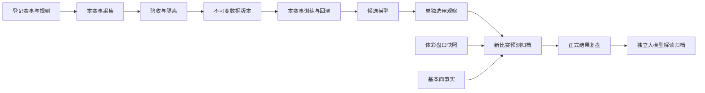

# 足球工作台：功能边界与执行约束

更新：2026-11-01。本文与根目录 AGENTS.md 是后续开发的入口。修改功能时先核对本文和实际代码；不以聊天记忆代替约束。

## 已落实的功能拆分

| 功能 | 责任与输出 | 代码入口 | 禁止的隐式行为 |
|---|---|---|---|
| 赛事登记 | 赛事标识、国家/赛区、来源映射、赛季、阶段、训练开关 | config/football_competitions.json、catalog.py | 根据球队名猜赛事；未接入杯赛套用联赛模型 |
| 数据采集 | 按赛事采集历史比赛、阶段与当季赛程，保留原始响应及摘要 | history_pipeline.py、history_audit.py | 一次采集覆盖另一赛事的采集文件 |
| 数据验收 | 来源、比分口径、身份、冲突、可用时间、使用依据；问题数据隔离 | research_dataset.py、training.validate_dataset | 把网页可访问当作商用授权；用赛后数据预测赛前 |
| 基本面 | 同赛事近期、主客表现、交锋、赛季统计；可取得的确认首发 | fundamentals.py、league_data.py | 杯赛结果计入联赛近期统计；伤停缺失视为无伤停 |
| 赔率 | 体彩五种玩法的来源快照、完整性、销售状态、新鲜度；市场参考 | sources.py、quality.py、store.py | 把参考概率当作训练模型；把配置项显示为已接通 |
| 数据集 | 单赛事、内容寻址的不可变版本；当前数据指针 | model_registry.py | 数据更新覆盖训练正在使用的版本 |
| 训练任务 | 每赛事独立任务和进度；同赛事排他锁，不同赛事可并行 | training_jobs.py、model_registry.train | 训练韩职替换日职；训练结束自动选用模型 |
| 离线评估 | 同赛事时间切分、滚动回测、候选比较、分阶段和分玩法指标 | training.py | 随机打散造成时间泄漏；测试集参与选参 |
| 模型管理 | 独立运行目录、完整性校验、选用/停止观察、保留历史版本 | model_registry.py | 选用别的赛事模型；缺失时悄悄借用全局模型 |
| 预测 | 按赛事路由已选观察模型，生成五种玩法、分析依据和缺失提示 | service.prediction、football_markets.py | 无盘口时虚构让球线；赛后补写为赛前预测 |
| 复盘 | 读取已归档输入、概率、选择与模型标识，按正式结果核对 | service.reviews、football_markets.settle_markets | 用新模型重算并覆盖旧预测；实时比分直接冒充官方结算 |

原始 HTTP 客户端可以共用，球队来源标识可以一致；赛事归属、训练样本、参数、评估、模型选择不得混用。当前没有引入跨赛事实力、伤停或赛程特征。未来要共享这类事实，必须增加明确的时间、赛事适用范围和单独回测，不能以“同一支球队”为由直接合并。

## 业务操作



页面先选择赛事。数据来源、基本面、赔率、模型、训练与赛事覆盖全部跟随该选择；所选赛事保存在浏览器本地。页面导入必须是含来源声明的历史 JSON；模型操作明确区分训练、选用观察、停止观察。

基本面用于展示与判断依据，不代表该字段已经进入统计模型。当前实际训练输入为本赛事 90 分钟全场/半场比分、球队身份、主客场和时间衰减。阶段保留用于评估分组，尚未作为独立参数拟合。伤停、xG、轮换、外盘、专家扫盘没有进入训练。

## 数据与模型存储

```text
data/training/
  history_staging.jp.j1.json       日职采集验收快照
  history_staging.kr.k1.json       韩职采集验收快照
  history_raw/                    可共享的原始响应归档
  competitions/<competition_id>/
    datasets/<内容摘要>.json        不可变训练输入
    dataset.json                  当前数据版本指针
    training.lock                 操作系统自动释放的赛事训练锁
    runs/<运行标识>/
      model.json                  参数与球队映射
      evaluation.json             指标及逐场回测记录
      manifest.json               赛事、数据、模型、报告摘要
    candidate.json                最近完成的训练
    observation.json              明确选用的观察模型
```

数据入库只修改目标赛事的当前数据指针；旧版本保留。模型始终引用自己的固定训练版本。即使训练途中导入新数据，当前任务也只使用启动时加载的数据。新数据不会使其他赛事模型失效，也不会重写历史预测。

原有 club_history.json、club_model.json、club_evaluation.json 留作迁移审计。线上控制台和新的训练命令不再读它们作为全局活动模型。training.py 中旧文件读写辅助函数仅保留给历史兼容/审计测试；不得重新接入业务路由。

## 训练与评估规则

- 控制台只运行 `separate`：每个赛事独立拟合全部参数，包括进球基准和主场影响。
- 至少 300 场、3 个赛季；按该赛事比赛日期切出约 60% 初始训练、20% 验证、20% 测试，验证/测试各至少 30 场。
- 验证比较 180/365 天衰减 × 泊松/两阶段低比分校正，共 4 个候选。低比分校正不是联合最大似然 Dixon–Coles 拟合。
- 根据验证集 log loss 选参，再在未参与选参的测试段按周更新；每场训练截止早于预测时点，预测时点为赛前 60 分钟。
- 当前旧历史记录采用“开赛后 7 天或实际采集时间，取较早者”的可用时间假设。它是明确的历史模拟假设，不是当年真实采集时间，报告不得混称实时回测。
- 展示 log loss、Brier、校准、分阶段/玩法结果。没有历史盘口的样本不计算市场增益、收益或历史让球命中率。
- 最终参数使用截至训练时已可用的本赛事数据。训练只生成候选；选用只进入前瞻观察。均匀基线比较不构成生产发布凭据。
- 旧预测继续关联当时模型、数据摘要和输入快照；新预测增加 competition_id、run_id 和 training_scope。

## 数据源的真实边界

体彩用于中国在售比赛与五种玩法 SP；500 历史赛果用于已验收的本地研究数据；官方赛果用于已有抽查；ESPN 在有精确匹配时补充日职首发等事实。数据质量以实际覆盖、冲突记录和时间戳为准，不声称全量双源核验。

目前外盘接口、完整伤停/资格、xG 和历史盘口仍缺失。付费接口配置预留不等于适配器接通。近期采集的盘口快照也不等于覆盖过去全部历史。新预测保留源数据检查和过期阻断；轮询不能证明上游毫秒级实时，不能承诺“绝对准确”。

## 新增欧冠、杯赛的准入

欧冠和天皇杯已登记为待接入，训练关闭，无来源映射和赛季规则时不能导入训练或套用其他赛事模型。新增任何杯赛必须具体到赛事，不能建一个泛化的“杯赛”桶。

接入时须明确：来源赛事 ID、赛季、阶段、轮次、单/双回合、中立场、首回合比分、90 分钟/加时/点球/晋级口径、球队参赛及停赛资格。当前日韩模型不含双回合总比分或晋级模型，这些字段未接通前必须保持该赛事训练关闭。统一球队身份可以建立关系，但不得把国内联赛数据自动标成欧冠训练标签。

完成来源适配、专属数据验收、独立训练回测后，再选用该赛事观察模型。新增赛事无需修改现有赛事的数据或选用指针。

## 可重复操作

所有命令在项目根目录执行，`--competition` 必填。以日职为例：

```powershell
.venv/Scripts/python.exe -m worldcup_mvp.console.history_pipeline --competition jp.j1
.venv/Scripts/python.exe -m worldcup_mvp.console.research_dataset --competition jp.j1 --request-reference "实际本地研究请求记录" --import-prepared
.venv/Scripts/python.exe -m worldcup_mvp.console.training --competition jp.j1 --evaluate
.venv/Scripts/python.exe -m worldcup_mvp.console.training --competition jp.j1 --observe <运行标识>
```

上述采集/研究入库是明确操作，不随页面轮询自动执行。授权来源的数据也可使用 `training --competition jp.j1 --import-file <JSON路径>` 导入。研究请求不能替代商业数据授权。

API 写操作：`POST /api/v1/datasets/import`（competition_id、dataset）、`POST /api/v1/training/evaluate`（competition_id）、`POST /api/v1/models/select`（competition_id、run_id；null 停止观察）。导入请求最大 16MB，页面文件最大 15MB；其他写请求保持原有大小限制与同源校验。

## 本次真实训练记录

| 项目 | 日职 | 韩职 |
|---|---|---|
| 入库样本 | 1,391 | 884 |
| 选中方法 | 独立泊松、180天衰减 | 独立泊松、180天衰减 |
| 测试起始 | 2026-02-22 | 2026-03-07 |
| 测试场次 | 300 | 194 |
| Log loss | 1.030137 | 1.107504 |
| Brier | 0.617285 | 0.673796 |
| 均匀基线对照 | 优于基线 | 未超过基线 |
| 运行标识 | bc24112258b94d78ad41d6998f113f28 | 51127eb86fc04208826d383604e2d7ac |

以上模型均单独选用为观察模型，未发布生产。韩职结果不足以证明有效预测能力。过去已归档的比赛分析没有用本次训练结果回写。

## 必须持续通过的验收

- 韩职导入和训练后，日职数据及模型文件逐字节不变。
- 同一赛事重复训练不并发；日韩任务可独立运行和失败。
- 训练中导入新数据不改变当前任务快照，不自动切换观察模型。
- 跨赛事模型选择、参数篡改、混入其他赛事、加时/点球口径均被拒绝。
- 未接入赛事不借用模型；原有预测/结果记录保持可追溯。
- 页面赛事切换同时改变数据和操作目标；导入、训练、选用请求均携带赛事标识。
- 表格单行、无页面横向溢出，桌面及移动宽度可操作。
- 后端回归、前端构建与浏览器流程通过。测试入口：tests/test_competition_isolation.py、tests/test_console_football_model.py、tests/test_model_workspace_status.py、frontend/e2e/console.spec.js。

2026-11-01 实际验收：后端 245 项、前端领域测试 3 项、浏览器流程 9 项通过；构建成功。真实本地服务的六个页面均无页面横向溢出、表格行高 58px；390px 移动宽度正常，未接入赛事训练按钮禁用，浏览器无脚本异常。复核材料位于本地 `.ai/tmp/isolation-*`，未作为产品数据写入。


## 赛后大模型复盘（2026-11-01 用户授权）

用户将“完全不接大模型”调整为“仅赛后复盘接入”。赛前预测、足球训练、程序结算和模型选用继续独立运行；AI 文本不作为训练数据，也不能触发自动调参。

- 入口：复盘记录表中的 AI 状态与“查看复盘”抽屉。自动生成、失败重试，个人笔记单独保存。完成报告计入“已复盘”，AI 状态独立显示。
- 自动触发：console-only 服务启动独立复盘线程，每分钟核查归档比赛的正式结果。必须具有常规90分钟正式比分、有效赛前输入快照、彼此一致的比分与胜平负。只有即时比分、比赛尚未结束或比赛取消时不生成。
- 输入：固定赛前预测、模型标识、程序核算的玩法覆盖/模拟单位结果/赛前分配给实际结果的概率和 log loss、已归档近期事实。只发送此比赛资料，不发送密钥、个人笔记或其他工作区数据。
- 输出：简短总结、带证据引用的偏差、待验证解释、缺失资料和后续检查。没有比赛事件、红牌或 xG 时不得编造赛后原因。结构或证据引用不合格的回复标记失败，不用本地模板冒充 AI 成功回复。
- 程序负责结果与指标，LLM 负责解释；单场偏差不能证明校准成败。模拟回报不是实际盈利。
- 存储：SQLite 独立 `ai_review_jobs` 表。输入摘要含比赛、赛事、预测归档、结果、提示词规则与所用大模型；原预测不修改。正式结果修正时创建新的复盘记录，旧报告保留审计。
- 幂等与恢复：相同输入只生成一次，数据库租约避免并发重复调用；中断租约可恢复，失败自动重试最多3次并逐次退避，页面可明确重试。每轮最多处理5项。报告查看和页面轮询不直接调用模型。
- 配置：沿用 `DEEPSEEK_API_KEY` / `DEEPSEEK_MODEL`；`FOOTBALL_AI_REVIEW_ENABLED=0` 关闭自动复盘。密钥未配置时显示未配置，不影响预测或手动笔记。服务停止后自动任务停止，未注册系统开机任务。
- API：`GET /api/v1/reviews` 提供 `ai_review_config` 和每场 `ai_review`；`POST /api/v1/reviews/generate` 使用 `match_id` 排队或重试。该操作先重新核实来源，已成功报告不重复生成。
- 当前不含正式比赛事件采集器。大模型只能复盘已有证据，未知比赛过程必须保留为未知。它的建议需人工评估与独立回测，不能直接成为生产规则。

验收覆盖：官方结果门槛、赛前归档时间、矛盾结果阻断、缺失密钥、未知引用拒绝、失败退避、并发防重、结果修正留档、原预测不变、个人笔记不外发、重试时未保存笔记不丢失。

赛后解读验收：255项后端测试、11项浏览器流程通过。已通过真实 DeepSeek 请求生成并保存10月31日柏太阳神—浦和红钻、光州FC—金泉尚武的复盘；真实服务桌面/移动抽屉检查无脚本异常及页面横向溢出。


## 2026-11-01 多模型探索比较

新增 `model_benchmark.py`，独立于观察模型训练/选用链路。命令：

```powershell
.venv/Scripts/python.exe -m pip install -r requirements-models.txt
.venv/Scripts/python.exe -m worldcup_mvp.console.model_benchmark --competition jp.j1
.venv/Scripts/python.exe -m worldcup_mvp.console.model_benchmark --competition kr.k1
```

输出在各赛事 `benchmarks/<运行ID>/report.json`；`latest.json` 仅为页面摘要。不写 candidate.json、observation.json，不覆盖历史预测。页面“训练与回测”按钮仍运行原进球候选训练；新增五模型探索比较由以上命令启动。

候选为180天泊松、两阶段低比分修正、联合正则化 Dixon–Coles、评级逻辑回归、CatBoost。联合DC同时拟合攻防、主场和相关参数，攻防分别零和约束，并保证所有球队组合低比分校正项为正；优化器不收敛会重试同一目标函数的约束优化器，仍失败则报错，不伪装成功。半全场仍是条件半场比例推导，不宣称独立半场动态模型。

评级特征是本赛事 Elo 差、双方近10场进失球及历史样本量；Elo更新率20、主场偏移60作为固定实验设定。每个训练样本与目标样本均只使用对应周初前可用的赛果。逻辑回归C=0.1；CatBoost深度3、120轮、学习率0.03、L2=10、固定种子42。分类器仅输出胜平负。没有使用外盘、xG、首发、伤停或专家文字。

时间分段沿用原数据切分，按验证集误差选优，再报告测试表现。由于该测试段之前已被审阅，明确标为“历史探索”，不能声称新的独立前瞻验证。前瞻验证、历史市场对照及新增基本面仍未完成。页面各行仅比较相同胜平负目标；其他玩法分数保留在完整报告，不混排不同玩法误差。

本次结果（胜平负Log loss；越低越好）：

| 模型 | 日职验证 | 日职测试300场 | 韩职验证 | 韩职测试194场 |
|---|---:|---:|---:|---:|
| 泊松 | 1.0354 | 1.0301 | 1.0848 | 1.1075 |
| 两阶段修正 | 1.0370 | 1.0300 | 1.0870 | 1.1029 |
| 联合DC | 1.0371 | 1.0301 | 1.0874 | 1.1028 |
| 评级逻辑回归 | 1.0562 | 1.0440 | 1.0821 | 1.1022 |
| CatBoost | 1.0470 | 1.0429 | 1.0856 | 1.1056 |

日职验证集仍选泊松；韩职选评级逻辑回归，但测试未超过均匀概率的1.0986。两者市场可比样本都为0。本次不切换观察模型，不能宣称预测可靠性已达标。下一步优先核查历史样本与时间假设、增加可验证基本面和盘口快照，而不是对已看过的测试集持续调参。

## 2026-11-01 统一训练与新增候选（替代上文当前入口说明）

页面训练、`training --evaluate` 与 `model_benchmark` 现在共用赛事训练服务。旧五模型实验仅保留审计，不再是页面外的另一条业务训练链路。依赖安装 `requirements-models.txt`。

- 方法共 7 种：泊松、两阶段修正、联合 DC、Elo 逻辑回归、CatBoost 分类、LightGBM 进球、动态 Gamma–Poisson；前两种比较 180/365 天，共 9 组配置。
- 默认目标 `full_time` 要求支持胜平负、总进球和比分，分类器只作对照；目标 `had` 允许分类器参与选优。页面、API `target` 和 CLI `--target` 同义。目标不合法在创建任务前拒绝。
- 方法登记、JSON 参数适配在 `model_methods.py`；统一时间滚动与评估在 `model_evaluation.py`。仍按验证集胜平负 Log loss 在兼容候选中选优，不宣称已经完成多玩法综合优化。
- 新训练只保存兼容目标的验证赢家为可选研究产物；其他方法的逐场概率和成绩保留用于对比。不会把每个实验方法自动变为观察模型。
- 历史测试段已经查看，所有新报告为 `research_only`，不称全新独立测试。未增加真实基本面或外盘来源；不根据今天四场结果修改参数或选项。
- LightGBM 为本地基础特征候选，非外部 J1 项目完整复现。动态 Gamma 为时间折扣、对手均值近似的共轭滤波，非论文 MCMC 复现。后验混合采用固定种子，预测、训练与结算均不依赖大模型。
- 半全场依然使用旧条件二项模块，独立半场/下半场模型尚未完成。模型支持玩法与实际缺失输入分开显示；分类器不显示预期进球。
- 新候选：日职 `800ef9353c8046aa80e51de90900db4f`；韩职 `0137d965b05a489c876eeadfce343834`。旧观察指针不变。完整汇总在 `data/reports/2026-11-01-model-expansion.json`。
- 263 项后端测试、3 项前端领域测试、11 项浏览器回归通过；实际 8891 服务的新资源加载、桌面及移动页面无溢出或脚本错误。用户原有 IAB 标签连接工具不可用，未声称该标签已刷新；实际服务验证使用独立浏览器。

尚需完成的数据增强、消融、置信区间和独立前瞻验收见 `docs/football-model-expansion-plan.md`，不能将本次新增候选视为预测准确率已达标。
