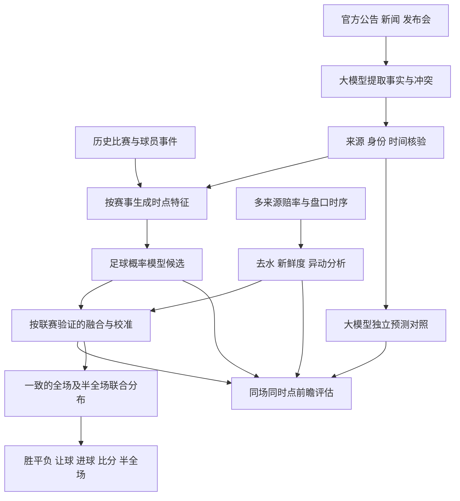

# 足球预测升级调研：比赛数据、赛前情报与市场

调研日期：2026-11-09。范围为开源实现、公开前瞻研究及本仓库实际产物核对。本次没有运行外部项目的训练、调用付费预测服务或更改生产模型选用。以下架构是建议，不能描述成已经上线。

## 结论

下一步应建设可验证的赛前情报与市场分析流程，同时保留统计模型和独立大模型预测对照。反复拟合同一批比分，不能解决阵容变化、情报时效、市场已吸收信息以及概率校准的问题。

基础模型仍有基准价值；当前证据不足以把它包装成有市场优势的推荐。引入大模型值得试验，但需要证明新增信息的贡献，不能用更长的分析文案代替准确性证据。

## 开源项目与实证研究

| 项目 | 可借鉴部分 | 限制与接入判断 |
|---|---|---|
| [penaltyblog](https://penaltyblog.readthedocs.io/en/latest/models/goal_expectancy.html) | 比分概率模型、赔率去水，以及由胜平负市场概率反推进球期望 | 市场反推的进球期望不是射门测量 xG，也不是独立足球信息；不能因此宣称优于市场 |
| [socceraction](https://github.com/ML-KULeuven/socceraction) | 统一事件格式，使用 xT、VAEP 衡量球员动作价值 | 需要事件级数据，现有球队汇总 xG 不足以直接运行；项目声明主要用于研究复现，不积极开发 |
| [Metaculus forecasting-tools](https://github.com/Metaculus/forecasting-tools) | 将检索研究与概率预测分成不同步骤，保留研究结果与预测过程 | 是通用预测框架，不是足球盈利模型；可参考编排方式，不照搬外部发布功能 |
| [LLM-SoccerArena](https://github.com/jonas-srd/world_cup_LLM_rank) | 真正赛前冻结预测、提示词、版本、检索痕迹及成本，比较不同信息条件 | 可借鉴实验设施，世界杯结果不能直接当作五大联赛成绩 |
| [PL_Predictor](https://github.com/kevinsigey/PL_Predictor) | 球员可用性、阵容延续性、统计模型与机器学习组合、赛前快照 | 个人项目，未复现其成绩；存在下述时间切分问题，不能直接用其报告认证我们的模型 |

阅读了实际实现而不只看 README：[Metaculus 研究与预测模板](https://raw.githubusercontent.com/Metaculus/forecasting-tools/main/forecasting_tools/forecast_bots/official_bots/template_bot_2026_fall.py)明确分开研究步骤；[PL_Predictor 的 manifest.py](https://raw.githubusercontent.com/kevinsigey/PL_Predictor/main/src/pl_predictor/models/manifest.py)将指定验证赛季以外的记录都列入训练，同时默认支持追加当前赛季。由代码可推断：在训练数据包含更晚赛季的条件下，这个验证集不构成严格向前测试。代码也明确承认部分报告是在同一选择集上挑优。可以借鉴功能，不能照搬验证口径。

大模型的实证证据并非“接入就提升”：2026 年 LLM-SoccerArena 预印本在 104 场世界杯中发现联网使 Brier 改善 0.023；最接近市场的模型为 0.497，市场为 0.498，差值没有统计显著优势。其 LLM 是赛前两小时预测，市场是收盘价，信息时点也不同。[论文正文及附录 E](https://arxiv.org/html/2607.24573v1)

另一份 56 场前瞻研究将数量分析与新闻分析分工，但两位专家在 50 场中至少重合两个前三比分；增加评论者与汇总者未必提供额外信息。这支持按数据职责分工，不支持“多找几个大模型投票就更准”。这也是小样本预印本，并非通用效果保证。[研究摘要](https://arxiv.org/abs/2609.12495)

## 我们实际有什么，缺的是什么

本次重新读取了 [11 月 6 日增强实验报告](2026-11-06-five-league-challenger-results.md)，并逐联赛读取 `data/research/big-five/2026-11-06/challenger/line-reports.json` 指向的实际 JSON。

- 已有独立 xG 增强实验。德甲、意甲在两个测试区间的比分误差均下降；英超均变差，西甲反转，法甲差距很小。不能统一宣称加入 xG 有效。
- 已有真实体彩整数让球研究：1,016 场训练、228 场测试。五联赛同场测试中，足球模型 Log loss 均高于市场；简单混合也没有胜过市场。
- 已有 2,123 场亚洲盘记录，其中当前测试季 407 场；缺逐场历史采集时点，不能冒充真实赛前冻结试验。
- 历史 xG 使用七天发布延迟假设，不能证明当时确已抓取。历史重新检索的新闻、大模型已知的赛果也不能拿来假装赛前预测。
- 11 月 9 日全量训练拟合了基础 DC/Elo；上述研究数据没有因此全部进入这些模型。“所有比赛参与训练”不等于“所有采集字段都入模”。

因此，先前笼统说“没有历史让球数据”不准确。正确表述是：本次基础回测没有关联真实盘口，而平台另有独立盘口研究。真正的缺口是统一数据身份、可用时间和研究版本，接入可复现的增强预测流程，并完成独立前瞻验收。

## 建议架构

融合模型是新的候选版本。足球概率、市场概率和 AI 独立概率分别保存，不能互相冒名。比赛身份、赛事规则、数据集、模型、报告及选用继续按赛事隔离；允许共享有时间戳的事实，不跨赛事隐式借用模型。

### 大模型具体做什么

1. 从俱乐部、赛事官方公告、发布会及可靠报道提取伤停、停赛资格、预计轮换、教练变化、旅行和赛程信息。记录原文证据、发布时间、首次采集时间、适用比赛与有效期；同一消息多站转载只算一条。
2. 区分已确认、预计、有争议和未知。预计首发不等于官方首发；“必须赢球”不能直接当成“会更强”。赛制、积分与资格条件优先用结构化规则核实。
3. 生成结构化特征和可核对的判断依据。球员缺阵的量化影响应由历史出场、替补能力、位置和球队表现估计，不能让大模型随口减去十个百分点。
4. 单独生成 AI 概率预测，保留消息依据、缺失项及简短理由。区分不看赔率与允许看赔率的试验条件，避免把复述赔率的能力当作独立增益。
5. 按新消息、官方首发或固定赛前节点触发更新；缓存相同证据。记录每场费用和耗时，避免每分钟重复推理相同内容。

增强统计模型可先比较“基础模型 + 往期 xG / 球员可用性 / 休息与阵容连续性”和梯度提升等候选。特征和超参数在验证段确定；融合权重、校准方法同样不能在最终测试段上挑选。现有德甲、意甲 xG 候选应优先复核，而不是重新假装从零开始。

### “诱盘”如何研究

建立“盘口异动与信息冲突”分析，观测以下事实：同盘口线的去水概率变化、不同来源的分歧、调价速度、新闻发生前后的变化，以及有实际来源时的成交量与流动性。交易所历史价格与结算档案可作为候选研究数据；可用字段和频率需逐套餐确认。[Betfair 官方说明](https://support.developer.betfair.com/hc/en-us/articles/360002407732-What-data-is-provided-by-the-Historical-Data-service)

仅凭降赔、升盘或最终爆冷，无法确认操盘意图。没有真实资金数据时，不显示“主力流入”“散户热度”；交易量本身也不说明哪方是专业资金。每条异动必须先排除过期报价、盘口线变化、市场规则差异及取消比赛。

实际数据源已有这类问题：Football-Data 明示自 2025-07-23 起 Pinnacle 部分报价系统性滞后。看似反常的价格差可能是数据陈旧。该站也明确限制商业和自动化 AI 训练等用途，不能将“免费可下载”视为平台生产使用授权。[数据源说明](https://football-data.co.uk/data)

需要验证的是：某类异动是否在独立未来比赛中改善概率、校准或风险识别。异动标签不能直接变成“反买热门”。目前仓库爆冷报警实验准确率 17.8%、召回率 12.9%，没有启用依据，也不能叫诱盘识别成功。

### 所有玩法如何保持一致

胜平负、总进球、比分及指定让球线由一致的全场比分分布导出。半全场需要额外的半场—全场联合分布，不能仅凭全场胜平负推断。90 分钟、加时、点球和晋级分别处理。

不同玩法的首选可以同时发生。例如客队净胜一球时，胜平负客胜与主队受让一球的让平同时成立。不能把不同玩法强制成互斥选项；也不能把每个玩法的最高概率选项拼成必然一致的单一比分。应核验概率分布和结算规则，并分别报告每个玩法的单选成绩、多选覆盖和未预测数量。

## 执行顺序与验收

| 顺序 | 任务 | 交付及验收条件 |
|---|---|---|
| 1 | 统一现有研究数据入口 | 清点并关联 xG、人员、真实盘口、已冻结前瞻；给出逐场覆盖与时间证据，不覆盖历史产物。数据来源实际使用权限明确 |
| 2 | 赛前情报采集与 AI 提取 | 每个事实可追溯到比赛、球队/球员、原文、发布时间和采集时间；核对错队、旧闻、转载、传闻与矛盾消息。缺失不填成正常 |
| 3 | 市场时序与异动 | 同场同线同规则；去水、更新延迟及来源分歧可重放；单点报价不能捏造走势，无资金数据不能捏造流向 |
| 4 | 增强候选与独立 AI 对照 | 按联赛训练和冻结配置；保留四组结果、失败原因、成本和输入摘要；检查未来信息、对手身份及跨赛事隔离 |
| 5 | 前瞻检验后单独决定选用 | 按共同场次与共同预测截止比较，公布不确定区间、覆盖率及失败数；测试期不挑最佳提示词或权重；无明确增益不晋级 |

四组沿用 [现有试验方案](2026-11-08-sweep-audit-and-llm-trial.md)：同期市场参考、足球模型、加入 AI 提取事实的模型、AI 独立判断。融合方法在验证期锁定后才进入另一轮候选测试，不把混合结果冒充独立模型优势。

固定主比较节点，例如赛前 60 分钟，所有组使用该时刻以前可见的数据。首发发布后的更新另设节点独立比较。既报告四组共同有效样本，也报告各组缺失、失败、拒绝预测与全部目标场次数，避免通过少报困难比赛提高成绩。

主要指标为各玩法 Log loss、Brier 与校准；单选准确率和多选覆盖分开。按联赛、赛季、强弱和资料完整度检查稳定性。模型收益只有在保存了当时实际可得报价、盘口、规则与执行假设时才评估；收盘价优势仅作补充，不能代替盈利证据。样本量依据可检测增益和置信区间规划，不以少数命中或任意固定小样本宣布有效。

首先应交付的是一批真正冻结的赛前事实、市场与四组预测，以及能复核的评估入口；不是再训练十个只有名称不同的模型。
