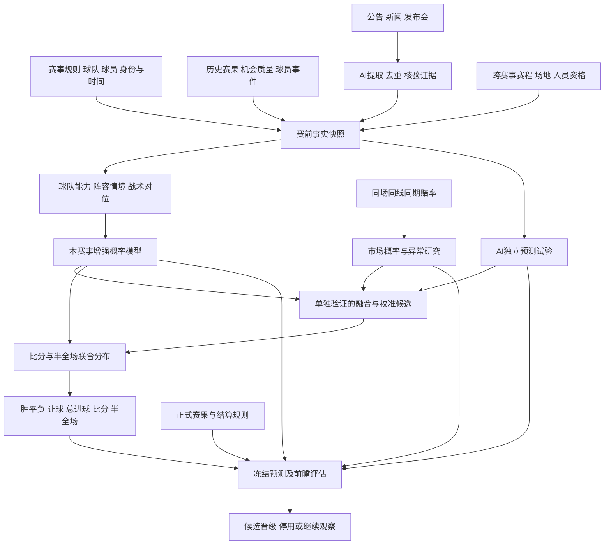

# 足球分析系统能力复核：业务、AI、依赖与取舍

日期：2026-11-09。性质：调研与待核对设计；未新增生产预测、未启动训练、未更换模型。依据为当前仓库代码、已有审计报告，以及本次重新查阅的官方产品说明、开源实现和研究论文。供应商功能说明不作为准确率证明；方案建议不标记为已实现。

后续结合独立五联赛观察板块、开盘及临场节点的统一任务与验收见 [本次调整清单](2026-11-09-five-league-observation-checklist.md)。该清单包含本报告的数据与模型增强范围，不仅是新增页面。

## 1. 本次要解决的问题

用户希望预测能综合球队真实能力、当期人员、比赛情境、交锋规律及市场信息，并验证大模型是否提供额外价值。五大联赛分别评估，保留胜平负、让球、总进球、比分、半全场；不能依靠多选掩盖单选成绩，也不能用市场概率冒充模型预测。

此前讨论的历史数据、模型版本、不可变预测和回测隔离继续保留。本次补充职业足球分析系统的能力地图，明确哪些与本平台目标有关，避免把俱乐部管理软件的全部功能照搬过来。

建议主链：**有来源的事实 → 当时的球队与阵容状态 → 对手及比赛情境 → 联合概率 → 市场比较 → 未来比赛验证**。AI 提取情报与 AI 独立判断分别接入，不能用一篇分析文章替代这条链。

## 2. 专业系统实际解决哪些问题

| 类型与本次查阅对象 | 实际工作 | 对本平台的意义 |
|---|---|---|
| 赛事预测：Opta Analyst | 公开的联赛预测方法使用市场赔率与球队评级估计胜平负，再模拟剩余赛程，得到排名分布 | 借鉴对手强度、概率和赛程规则的组合；其输出含市场信息，不是纯足球模型对市场的独立胜利证据 |
| 球队与球员表现分析：Hudl Statsbomb | 用射门情境评估 xG，用 OBV 等模型衡量有球动作价值，并提供事件、位置和视频分析 | 补充机会创造、推进、球员角色和对手分析；这些指标本身不等于赛果预测 |
| 数据标准化：kloppy | 将不同供应商事件与追踪数据转换到共同模型 | 未来接事件级数据时复用适配思路；当前只有比赛汇总的数据不必强行改成事件模型 |
| 动作价值研究：socceraction | SPADL 事件转换、xT、VAEP 实现 | 可用于战术和球员特征研究；需要事件数据，项目也声明并非积极开发中 |
| 大模型预测编排：Metaculus forecasting-tools | 先检索研究，再生成概率并聚合；代码明确分离研究与预测 | 借鉴证据、预测版本和评估流程；不是现成的足球准确率认证 |
| 大模型前瞻实验：LLM-SoccerArena | 比赛前运行并冻结 LLM 预测，研究检索、提示方式和概率质量 | 借鉴实验设计；世界杯样本的结论不能直接移植到五大联赛 |

来源：[Opta 方法](https://theanalyst.com/articles/opta-football-predictions)、[Hudl 产品](https://www.hudl.com/en_gb/products/statsbomb)、[kloppy 文档](https://kloppy.pysport.org/user-guide/getting-started/)、[socceraction](https://github.com/ML-KULeuven/socceraction)、[Metaculus 实际模板](https://raw.githubusercontent.com/Metaculus/forecasting-tools/main/forecasting_tools/forecast_bots/official_bots/template_bot_2026_fall.py)、[LLM-SoccerArena 论文](https://arxiv.org/html/2607.24573v1)。

俱乐部系统还服务球探、训练计划、负荷管理、康复和视频剪辑。这些具有自己的业务价值，但本平台当前目标是赛前预测，不能因此全部列为必建模块。

## 3. 与当前代码逐项核对

下表的“已有”表示查到实现或具体审计产物，不表示所有比赛覆盖完整或已经证明有效。历史数量引用对应审计日期，未在本次重新扫描全部原始数据库。

| 能力 | 当前证据 | 真正缺口 | 决策 |
|---|---|---|---|
| 赛事、规则、球队身份及隔离 | 已有赛事目录、独立数据集/训练/产物/选用、历史归档 | 增量采集仍需处理来源修正、升降级与新赛季；不能为新赛事自动借用别的模型 | 保留完善，不重建 |
| 球队、球员、教练历史 | 11 月 6 日审计已有 138 家历史俱乐部、580 个球队赛季，逐场人员分钟与教练资料 | 赛季接口存在旧教练/残缺名册；转会生效、注册资格、教练任期需要时点证据 | 先完善时间关系，不另造一套孤立球队库 |
| 基础实力与机器学习 | `model_methods.py` 有 DC、动态 Gamma、Elo、CatBoost、LightGBM 等候选；后几类主要读取七维 Elo/近期进失球/样本量 | 模型名称增加没有同时带来阵容、战术等输入；候选存在不代表已选用 | 保留基准，升级有效输入 |
| 历史 xG 与比赛统计 | 9,358 场历史审计及增强研究已经存在 | 供应商定义、修订和历史可用时间不同；尚无通用于各联赛的稳定提升证据 | 复用；按联赛继续验证，不重复采集一遍 |
| 赛前人员与情报 | `fundamentals.py`、`personnel` 和 `intelligence.py` 有采集、校验、展示；后者明确不改变概率 | 缺完整的赛前可用人员、预计上场时间、替补差距和阵容情境到概率的受测流程 | 优先建设 |
| 赛程与负荷 | `schedules.py` 和基本面有公共赛程；历史休息/分钟已有研究 | 展示用赛程不等于完整训练特征；要补杯赛、欧战、国家队出场、旅行与加时负荷 | 优先连接事实和特征；共享事实不混合训练标签 |
| 战术、对位与交锋 | 有近期/主客/交锋展示和 H2H 实验 | 未发现已验证的战术交互模型；需要区分实力差、教练/核心阵容延续和打法对位 | 值得研究，先少量可检验特征 |
| 赔率与市场 | 有体彩逐次报价、冻结参考、真实让球及市场增强研究 | 多来源一致性、新闻前后反应和实际市场深度覆盖不足；没有已验证的“诱盘识别” | 继续建设市场分析，不推翻现有留档 |
| 五玩法概率 | `football_markets.py` 从全场比分分布导出四类玩法；半全场依赖条件半场分配 | 半全场尚是简化时间假设，未模拟领先/落后后的行为变化；分类模型只支持胜平负 | 保留五玩法，按能力披露和分别升级 |
| 校准、选择与验证 | 已有滚动评估、概率评分、校准研究、冻结与显式选用 | 赛前四组持续对照未完整落地；缺增强链路稳定的前瞻效果和运营监测证据 | 优先接成闭环，不称为从零建设 |

复核入口：[系统契约](../football-system-contract.md)、[人员审计](2026-11-06-big-five-club-personnel-audit.md)、[最新增强结果](2026-11-09-context-backtest-results.md)、[模型代码](../../worldcup_mvp/console/model_methods.py)、[情报代码](../../worldcup_mvp/console/intelligence.py)、[赛程代码](../../worldcup_mvp/console/schedules.py)、[玩法代码](../../worldcup_mvp/console/football_markets.py)。早期报告中的“尚未训练/无候选”应按其日期理解；11 月 9 日已完成基础全量拟合和另行增强研究，不能拿早期状态覆盖最新结果。

## 4. 用户想法如何关联，怎样避免重复计权

| 用户提出的线索 | 对应的可检验问题 | 依赖与处理 |
|---|---|---|
| 主队长期赢同一个对手 | 是持续实力优势、主场因素，还是特定战术克制？ | 先控制当时双方实力与主客，再看交锋是否仍增加信息；按教练/核心阵容变化、年代和样本量衰减 |
| 两队历史经常平局 | 是否低机会比赛，或双方强度接近、节奏慢、赛制容许平局？ | 平局频次与低进球/实力接近可能重复；先比较这些因素，再验证剩余交锋效应 |
| 连胜、连败、强队爆冷 | 近期表现是否超出创造机会的质量和对手难度？ | 将往期进球与 xG、结果与事前预期分开；红牌和早早领先会改变控球、射门等统计，不能直接归因能力变化 |
| 诱上盘、诱下盘 | 是否存在价格过度反应、热门偏差或消息与报价反应不匹配？ | 先排除过期报价和盘口换线；研究可观察价格偏差，操盘意图留为未经证实解释 |
| AI 综合情报判断 | 伤停、教练变化、轮换、旅行是否带来基准未表达的新信息？ | 消息去重、时间核验、身份关联；把事实影响与 LLM 自己的概率判断分开保存 |
| 战意、保级、争冠、德比 | 明确规则和积分形势是否改变轮换或比赛策略？ | 积分与晋级条件按规则计算；“必须赢”不自动增加胜率。情绪动机没有证据时只作待检验假设 |
| 多种玩法都预测 | 同一场比赛的不同结算事件分别有多大概率？ | 联合比分与半全场分布提供共用基础；不能从三个胜平负概率唯一还原比分/进球/半全场 |
| 几千场都用起来 | 哪些可用历史能支持拟合，哪些只能支持描述？ | 截止前合格数据可用于最终拟合，但测试目标不能预先进入对应模型；字段适用性与比赛数量分开统计 |

市场过度反应有实证研究支持作为假设：Wheatcroft 用历史赔率对应的预期表现衡量近期超预期/低于预期，研究后续定价偏差。它不证明任意降赔都是诱盘，也不是直接交锋规律研究；旧时期效果必须用现在的可得价格重新验证。[论文](https://www.degruyterbrill.com/document/doi/10.1515/jqas-2019-0009/html)

具体防重复例子：同一前锋受伤，可能同时出现在三家新闻、预计首发变化、人员评分与赔率变动中。应只生成一条有版本的缺阵事实；人员模型衡量替代后的影响，市场模块记录价格是否已反映。融合通过验证学习贡献，不能把四处出现当四个独立利空相加。赔率已经含部分公众信息；“模型与市场一致”也不代表多条独立证据。

## 5. AI 实际如何预测

### 5.1 数量模型：从历史关联学习概率

本平台已有的 DC/Poisson 估计进球强度及低比分关系；Elo/机器学习估计球队相对能力或比赛结果。建议新增输入包括对手调整后的机会创造/防守、当期预计阵容、替补差距和赛程负荷，再比较相应模型。采用何种算法由验证结果决定，不能承诺神经网络或更大模型必胜。

职业分析中的 xG 是“给定一次射门情境，进球的概率”；比赛前还不知道会产生哪些射门，需要进一步预测机会数量与质量。Statsbomb 的公开技术文说明其 xG 使用梯度提升树，并引入门将、防守者位置和约束。不能将比赛赛后的 xG、射门或实际首发倒填到本场赛前输入。[技术文](https://www.hudl.com/blog/upgrading-expected-goals)

### 5.2 大模型提取情报：把文字变成可验证事实

输入：截至指定时间可获得的官方公告、发布会、可靠报道及已有结构化资料。

输出：球队/球员 ID、事件类型、适用比赛、来源、发布时间、首次采集时间、有效期、已确认/预计/冲突、原文证据。独立保存“来源可信度”和“结果概率”；不能把大模型说自己很有把握直接标成 90% 命中率。

人员特征进一步描述预计位置与分钟、替补能力、搭档延续性。影响估计需用历史拟合、收缩和验证处理小样本及选择偏差，不能口头指定“少一个前锋就减 10%”。赛前只使用预计分钟；实际分钟只能在赛后进入后续比赛的历史。

### 5.3 大模型独立判断：可以实验，必须独立计分

给定冻结事实、比赛规则、预测截止和输出结构，让 LLM 独立给出概率与可核对的简短依据。固定模型版本、提示词、工具范围与失败重试；拒绝非法概率，保留失败，不能不断重试到想要的方向。

“不提供赔率”的组检验结构化事实与推理能力；“提供同期赔率”的组检验是否超出市场参考。两者分别记录，不能混为一组独立信息。检索页面若夹带赔率也需记录；盲测只能称未显式提供市场数据，除非隔离确实到位。两组都不能读取其他候选的最终答案再声称独立。

公开的 LLM-SoccerArena 预印本在 104 场世界杯中，最接近市场的模型 Brier 为 0.497，收盘市场为 0.498；差异没有显著优势，而且 LLM 在赛前两小时预测，市场多了最后两小时信息。它支持做真实赛前对照，不支持“用了大模型就已经超过市场”。[论文附录 E](https://arxiv.org/html/2607.24573v1)

第一阶段若 LLM 只输出胜平负，只给该玩法计分，不伪造其余四种能力。覆盖五玩法的下一阶段需明确完整比分及半场条件分布的输出协议，保存原始与一致性处理后的概率，验证后者是否改善；不能事后选最命中的玩法。

### 5.4 情境预测与融合：处理当下不确定性

例如某核心球员是否首发尚未确定，分别估计“首发”“替补”“缺阵”下的比赛分布，再按有证据、可评估的情境概率加权。正式名单发布后形成新版本，保留原预测。三种概率无依据时，不由 LLM 随意编数，按经过验证的缺失策略处理。

`P(赛果 | 当前证据) = Σ P(赛果 | 阵容情境, 当前证据) × P(阵容情境 | 当前证据)`

这是建议建模方法，不是本仓库已部署能力。市场、足球增强模型和 LLM 输出的融合另建候选，用独立验证段学习权重及校准；各原始组继续保留。模拟次数增加只能减少模拟数值误差，不能自动修复错误输入或假设。

## 6. 修订后的关系图

图中 AI → 融合是后续候选实验，不是默认投产路径。赔率可提供给明确标记的 AI 市场辅助组；市场盲组不接这条输入。基础模型作为原样对照持续留存，不能在增强实验中悄悄改变。

共享的是球员/球队稳定身份和有时间戳的事实；每个赛事自己的准入、特征版本、拟合、报告、模型及选用继续隔离。参加欧冠的出场分钟可作为已核实负荷事实；不能顺便把欧冠标签混入英超训练，也不能把欧冠停赛自动套到联赛。

## 7. 必须补、后续研究与暂时不做

### 优先补齐

1. **可重放的赛前资料包。** 复用现有采集，补每场实际覆盖、来源冲突、有效期、未知和修订。重点是阵容资格、人员变动及完整负荷，不要求所有字段都齐才能跑任何模型。
2. **人员和球队状态。** 使用时间有效的球队—球员—教练关系，估计预计阵容、分钟与替补差距；原来只有赛后台账的字段不得充当赛前事实。
3. **四组前瞻运行。** 同期市场参考、原基础模型、AI 事实增强模型、AI 独立判断。先运行和保存，再谈融合；每个时点分别评分。
4. **联赛与玩法分开的验证和监测。** 继续复用已有回测工具，接入上述新数据、输入缺失、概率校准、来源延迟和漂移观察。生产选用仍是独立操作。

### 在有数据和验证依据后建设

- **战术交互与历史交锋残差：** 高位逼抢/后场出球、定位球攻防、转换进攻、低位防守、空中对抗等；先从稳定可取得的事件特征开始。总控球或总传球数不能自动证明战术克制。
- **半全场与比赛状态模型：** 增加进球时序、比分状态、红牌等历史事件。赛前预测需对尚未发生的红牌等事件积分或模拟；不能用本场未来事件作为已知输入。实时比分展示与滚球预测属于不同能力。
- **盘口异动和热门偏差：** 多来源、同线报价、新闻时点先成立，再测试超预期表现和反应延迟。赔率偏差研究与比赛操纵调查分开。
- **天气、裁判、旅行和场地：** 有明确作用路径，也有覆盖和噪声问题；按任务做消融。天气使用当时预报而非赛后实测，裁判使用当时指派记录；不是所有联赛必需输入。

### 当前不投入或明确排除

| 项目 | 原因及替代 |
|---|---|
| 完整球探采购、俱乐部训练/医疗康复工作流 | 超出当前赛果预测目标；只取必要、可获得的状态事实 |
| 为所有比赛自建视频追踪和 22 人全场坐标 | 数据与工程成本高；先验证现有事件和汇总数据的贡献。StatsBomb 开放库只覆盖选定赛事，360 也仅部分比赛，不能当成全覆盖免费接口 |
| 从零训练足球大语言模型，或立即微调 | 先用现成模型验证抽取和预测；没有合格时点数据与独立收益证据，微调会固化偏差 |
| 多个 AI 换角色重复投票 | 信息源高度重复时不提供相应独立信息；先测单模型及证据增量，融合按验证成绩决定 |
| 给“诱盘”“战意”“必爆冷”任意打分后人工加减概率 | 缺稳定标签和校准依据；改成可观察事实、候选特征及前瞻假设 |
| 用大模型填补未知伤停、首发、资金流 | 文本生成不能补事实缺口；可输出预计情境，但必须明确不确定性且有方法依据 |
| 把所有字段和所有联赛直接一起训练 | 无关字段可能增加噪声；混合训练违反现行隔离约束。完整覆盖不等于无差别入模 |
| 强制每场给“值得买”的结论 | 概率预测与价格决策分开；没有市场优势也可展示预测，不制造推荐 |

开放数据范围依据：[StatsBomb Open Data README](https://raw.githubusercontent.com/hudl/open-data/master/README.md)。开源代码许可与数据使用权分别核实，不能由其中一项推定另一项。

## 8. 实施依赖与验收，不在本次直接执行

| 顺序 | 任务及依赖 | 可核对交付 |
|---|---|---|
| T1 | 复核现有逐场资料；依赖比赛/球队/人员身份 | 五联赛赛前覆盖清单，逐项区分历史赛后、真实赛前、回溯假设；查明可稳定持续取得的输入 |
| T2 | 人员、负荷、情报事实；依赖 T1 | 有时间版本的人员资格与证据包；错队、转载、旧闻、转会、冲突和首发变化的核验用例 |
| T3 | 增强模型及情境特征；依赖 T2 | 对手调整、阵容/替补/负荷的少量候选；按联赛消融，保留失败和没有提升的结果 |
| T4 | LLM 独立预测及四组冻结；依赖 T1/T2，增强组完成后接入 T3 | 相同比赛、相同预测截止；模型/提示词/证据/概率/成本/失败全量留档；不看赔率与看赔率分组 |
| T5 | 新的前瞻样本评估；依赖 T4 和正式赛果 | 五玩法分别给概率误差、校准、单选准确率、多选覆盖、失败/未预测数和不确定区间；比较共同场次并报告全目标覆盖 |
| T6 | 显式选择候选；依赖 T5 达标 | 按赛事单独选用、停止或继续观察；原预测与旧产物不改。无稳定增益就保留基准 |

执行前锁定主要指标、观察窗口、最小可检测改善和停止规则；按比赛周/赛季结构评估不确定性，不因为刚连中几场就提前宣布胜出。研究特征、提示词与融合权重都只能用训练/验证段选择。已经多次研究过的历史用于排错和探索，真实新前瞻用于确认，不能用重新抓取的新闻假装重现过去 LLM 的知识状态。

评估要回答两件不同的事：整体预测概率是否更准确，以及在当时可取得的价格下是否存在优势。后者需真实报价、结算规则和成本，不用更高命中率直接替代。当前阶段不加入自动下注。

本次新增价值集中在：**当前人员与替补影响、跨赛事负荷、战术交互、阵容情境、市场重复信息控制，以及四组真实前瞻验证**。已有隔离、归档、五玩法计算和回测设施继续复用；暂不以新增页面或模型数量作为完成标准。
